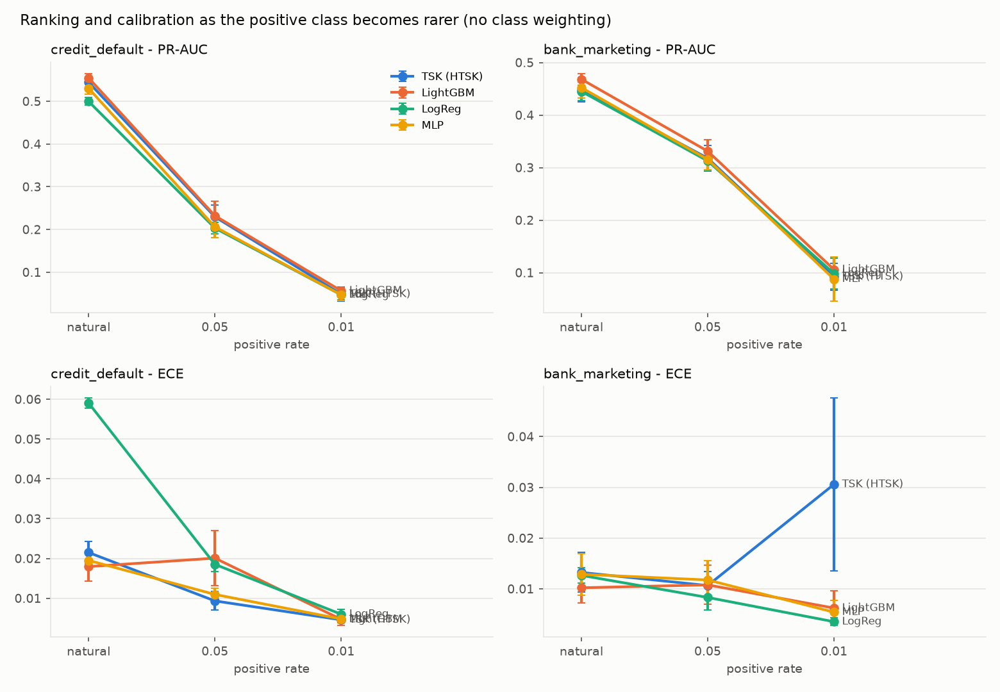
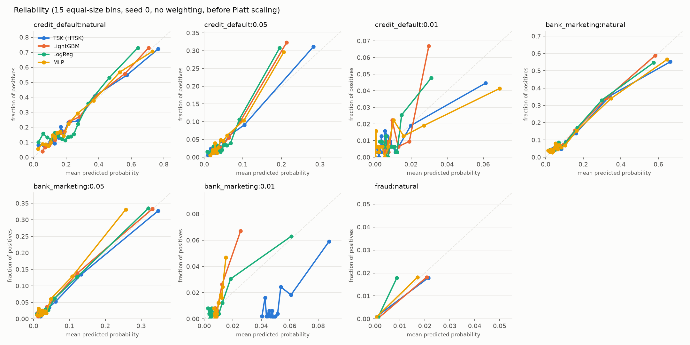

# Results: full

Seeds: [0, 1, 2, 3, 4]; configurations per model and setting: 20; max epochs 100, patience 10. Values are mean ± std over seeds.

## Data (seed 0 split)

| setting                |   test_size |   positives_test |   duplicates_train_test |
|:-----------------------|------------:|-----------------:|------------------------:|
| credit_default:natural |        6000 |             1327 |                      17 |
| credit_default:0.05    |        4920 |              246 |                      12 |
| credit_default:0.01    |        4720 |               47 |                      10 |
| bank_marketing:natural |        8238 |              928 |                     495 |
| bank_marketing:0.05    |        7695 |              385 |                     451 |
| bank_marketing:0.01    |        7384 |               74 |                     427 |
| fraud:natural          |       56962 |               75 |                     648 |

## Main results (test split)

PR-AUC is the primary metric. `ece` uses 15 equal-size bins; slope 1 / intercept 0 is perfect calibration; `platt_*` are after Platt scaling fitted on the calibration split; F1 at the threshold chosen on the calibration split.

| setting                | model   | class_weight   | pr_auc        | roc_auc       | brier         | ece           | cal_slope       | cal_intercept   | platt_brier   | platt_ece     | f1            |   n_seeds |
|:-----------------------|:--------|:---------------|:--------------|:--------------|:--------------|:--------------|:----------------|:----------------|:--------------|:--------------|:--------------|----------:|
| credit_default:natural | tsk     | False          | 0.544 ± 0.012 | 0.774 ± 0.010 | 0.136 ± 0.002 | 0.021 ± 0.003 | 0.976 ± 0.068   | -0.006 ± 0.031  | 0.136 ± 0.002 | 0.022 ± 0.004 | 0.537 ± 0.010 |         5 |
| credit_default:natural | lgbm    | False          | 0.555 ± 0.010 | 0.782 ± 0.005 | 0.134 ± 0.001 | 0.018 ± 0.004 | 1.051 ± 0.027   | 0.012 ± 0.013   | 0.134 ± 0.001 | 0.019 ± 0.006 | 0.546 ± 0.008 |         5 |
| credit_default:natural | logreg  | False          | 0.500 ± 0.009 | 0.720 ± 0.007 | 0.146 ± 0.001 | 0.059 ± 0.001 | 0.953 ± 0.071   | 0.007 ± 0.009   | 0.146 ± 0.001 | 0.060 ± 0.001 | 0.511 ± 0.004 |         5 |
| credit_default:natural | mlp     | False          | 0.530 ± 0.014 | 0.770 ± 0.006 | 0.138 ± 0.002 | 0.020 ± 0.002 | 0.983 ± 0.046   | 0.028 ± 0.035   | 0.138 ± 0.002 | 0.019 ± 0.003 | 0.529 ± 0.007 |         5 |
| credit_default:natural | tsk     | True           | 0.547 ± 0.014 | 0.776 ± 0.009 | 0.181 ± 0.006 | 0.202 ± 0.008 | 0.939 ± 0.068   | -1.221 ± 0.042  | 0.136 ± 0.002 | 0.019 ± 0.003 | 0.538 ± 0.010 |         5 |
| credit_default:natural | lgbm    | True           | 0.544 ± 0.006 | 0.780 ± 0.004 | 0.154 ± 0.002 | 0.126 ± 0.004 | 2.866 ± 0.628   | -0.408 ± 0.100  | 0.136 ± 0.001 | 0.024 ± 0.003 | 0.541 ± 0.009 |         5 |
| credit_default:natural | logreg  | True           | 0.497 ± 0.009 | 0.720 ± 0.008 | 0.207 ± 0.001 | 0.234 ± 0.001 | 1.053 ± 0.082   | -1.232 ± 0.008  | 0.146 ± 0.001 | 0.056 ± 0.002 | 0.510 ± 0.004 |         5 |
| credit_default:natural | mlp     | True           | 0.532 ± 0.009 | 0.773 ± 0.006 | 0.184 ± 0.009 | 0.209 ± 0.019 | 0.981 ± 0.038   | -1.233 ± 0.089  | 0.137 ± 0.001 | 0.017 ± 0.003 | 0.531 ± 0.004 |         5 |
| credit_default:0.05    | tsk     | False          | 0.229 ± 0.027 | 0.751 ± 0.020 | 0.043 ± 0.001 | 0.009 ± 0.002 | 1.058 ± 0.053   | -0.079 ± 0.036  | 0.043 ± 0.001 | 0.009 ± 0.001 | 0.314 ± 0.030 |         5 |
| credit_default:0.05    | lgbm    | False          | 0.232 ± 0.034 | 0.777 ± 0.009 | 0.044 ± 0.002 | 0.020 ± 0.007 | 1.780 ± 0.692   | 0.033 ± 0.011   | 0.043 ± 0.001 | 0.009 ± 0.001 | 0.305 ± 0.042 |         5 |
| credit_default:0.05    | logreg  | False          | 0.203 ± 0.014 | 0.727 ± 0.022 | 0.044 ± 0.000 | 0.019 ± 0.002 | 1.077 ± 0.096   | -0.002 ± 0.015  | 0.044 ± 0.000 | 0.019 ± 0.002 | 0.310 ± 0.024 |         5 |
| credit_default:0.05    | mlp     | False          | 0.206 ± 0.026 | 0.754 ± 0.018 | 0.044 ± 0.001 | 0.011 ± 0.002 | 1.092 ± 0.163   | 0.057 ± 0.103   | 0.044 ± 0.001 | 0.009 ± 0.002 | 0.295 ± 0.023 |         5 |
| credit_default:0.05    | tsk     | True           | 0.225 ± 0.017 | 0.760 ± 0.011 | 0.180 ± 0.015 | 0.350 ± 0.021 | 0.974 ± 0.106   | -2.940 ± 0.066  | 0.043 ± 0.001 | 0.010 ± 0.001 | 0.308 ± 0.032 |         5 |
| credit_default:0.05    | lgbm    | True           | 0.193 ± 0.018 | 0.755 ± 0.016 | 0.092 ± 0.017 | 0.157 ± 0.021 | 0.738 ± 0.144   | -1.986 ± 0.332  | 0.044 ± 0.001 | 0.017 ± 0.003 | 0.311 ± 0.013 |         5 |
| credit_default:0.05    | logreg  | True           | 0.198 ± 0.013 | 0.726 ± 0.024 | 0.205 ± 0.002 | 0.387 ± 0.004 | 1.269 ± 0.123   | -2.879 ± 0.011  | 0.045 ± 0.000 | 0.018 ± 0.004 | 0.304 ± 0.032 |         5 |
| credit_default:0.05    | mlp     | True           | 0.197 ± 0.014 | 0.755 ± 0.018 | 0.180 ± 0.019 | 0.321 ± 0.046 | 0.715 ± 0.155   | -3.019 ± 0.154  | 0.044 ± 0.001 | 0.013 ± 0.002 | 0.299 ± 0.018 |         5 |
| credit_default:0.01    | tsk     | False          | 0.049 ± 0.017 | 0.716 ± 0.051 | 0.010 ± 0.000 | 0.005 ± 0.001 | 0.828 ± 0.234   | -0.027 ± 0.072  | 0.010 ± 0.000 | 0.005 ± 0.001 | 0.101 ± 0.034 |         5 |
| credit_default:0.01    | lgbm    | False          | 0.057 ± 0.008 | 0.754 ± 0.038 | 0.010 ± 0.000 | 0.005 ± 0.002 | 1.368 ± 0.206   | 0.054 ± 0.022   | 0.010 ± 0.000 | 0.004 ± 0.002 | 0.086 ± 0.035 |         5 |
| credit_default:0.01    | logreg  | False          | 0.047 ± 0.012 | 0.700 ± 0.031 | 0.010 ± 0.000 | 0.006 ± 0.001 | 1.143 ± 0.119   | -0.007 ± 0.011  | 0.010 ± 0.000 | 0.005 ± 0.002 | 0.072 ± 0.024 |         5 |
| credit_default:0.01    | mlp     | False          | 0.047 ± 0.014 | 0.713 ± 0.048 | 0.010 ± 0.000 | 0.005 ± 0.001 | 0.752 ± 0.288   | 0.063 ± 0.231   | 0.010 ± 0.000 | 0.005 ± 0.000 | 0.075 ± 0.051 |         5 |
| credit_default:0.01    | tsk     | True           | 0.049 ± 0.009 | 0.738 ± 0.049 | 0.182 ± 0.028 | 0.365 ± 0.053 | 0.691 ± 0.124   | -4.723 ± 0.105  | 0.010 ± 0.000 | 0.005 ± 0.001 | 0.088 ± 0.067 |         5 |
| credit_default:0.01    | lgbm    | True           | 0.047 ± 0.012 | 0.738 ± 0.017 | 0.102 ± 0.045 | 0.221 ± 0.087 | 0.638 ± 0.137   | -3.930 ± 0.788  | 0.010 ± 0.000 | 0.005 ± 0.001 | 0.098 ± 0.023 |         5 |
| credit_default:0.01    | logreg  | True           | 0.046 ± 0.012 | 0.709 ± 0.041 | 0.198 ± 0.006 | 0.407 ± 0.012 | 0.870 ± 0.161   | -4.555 ± 0.020  | 0.010 ± 0.000 | 0.005 ± 0.002 | 0.074 ± 0.057 |         5 |
| credit_default:0.01    | mlp     | True           | 0.042 ± 0.014 | 0.715 ± 0.051 | 0.155 ± 0.035 | 0.314 ± 0.060 | 0.556 ± 0.198   | -4.488 ± 0.350  | 0.010 ± 0.000 | 0.005 ± 0.001 | 0.059 ± 0.040 |         5 |
| bank_marketing:natural | tsk     | False          | 0.447 ± 0.021 | 0.787 ± 0.012 | 0.079 ± 0.002 | 0.013 ± 0.004 | 0.941 ± 0.070   | -0.027 ± 0.041  | 0.079 ± 0.002 | 0.012 ± 0.002 | 0.489 ± 0.013 |         5 |
| bank_marketing:natural | lgbm    | False          | 0.468 ± 0.011 | 0.799 ± 0.010 | 0.077 ± 0.001 | 0.010 ± 0.003 | 1.015 ± 0.073   | 0.012 ± 0.007   | 0.077 ± 0.001 | 0.010 ± 0.002 | 0.505 ± 0.010 |         5 |
| bank_marketing:natural | logreg  | False          | 0.445 ± 0.017 | 0.788 ± 0.011 | 0.079 ± 0.001 | 0.013 ± 0.002 | 0.995 ± 0.054   | 0.006 ± 0.007   | 0.079 ± 0.001 | 0.012 ± 0.002 | 0.481 ± 0.012 |         5 |
| bank_marketing:natural | mlp     | False          | 0.452 ± 0.020 | 0.790 ± 0.011 | 0.078 ± 0.002 | 0.013 ± 0.004 | 0.954 ± 0.076   | 0.011 ± 0.086   | 0.078 ± 0.002 | 0.011 ± 0.004 | 0.490 ± 0.018 |         5 |
| bank_marketing:natural | tsk     | True           | 0.445 ± 0.016 | 0.787 ± 0.010 | 0.165 ± 0.003 | 0.273 ± 0.011 | 0.915 ± 0.076   | -2.099 ± 0.011  | 0.079 ± 0.002 | 0.012 ± 0.001 | 0.489 ± 0.013 |         5 |
| bank_marketing:natural | lgbm    | True           | 0.446 ± 0.016 | 0.796 ± 0.010 | 0.092 ± 0.000 | 0.105 ± 0.003 | 3.683 ± 0.200   | -0.459 ± 0.005  | 0.079 ± 0.001 | 0.023 ± 0.003 | 0.499 ± 0.011 |         5 |
| bank_marketing:natural | logreg  | True           | 0.436 ± 0.015 | 0.787 ± 0.010 | 0.168 ± 0.001 | 0.284 ± 0.003 | 1.053 ± 0.052   | -2.024 ± 0.005  | 0.080 ± 0.001 | 0.012 ± 0.002 | 0.482 ± 0.012 |         5 |
| bank_marketing:natural | mlp     | True           | 0.451 ± 0.018 | 0.789 ± 0.012 | 0.159 ± 0.005 | 0.268 ± 0.009 | 0.926 ± 0.097   | -2.052 ± 0.091  | 0.079 ± 0.002 | 0.014 ± 0.004 | 0.488 ± 0.013 |         5 |
| bank_marketing:0.05    | tsk     | False          | 0.318 ± 0.024 | 0.800 ± 0.013 | 0.040 ± 0.001 | 0.011 ± 0.003 | 1.059 ± 0.065   | -0.118 ± 0.047  | 0.040 ± 0.001 | 0.010 ± 0.002 | 0.357 ± 0.021 |         5 |
| bank_marketing:0.05    | lgbm    | False          | 0.331 ± 0.022 | 0.812 ± 0.009 | 0.040 ± 0.000 | 0.011 ± 0.004 | 1.170 ± 0.130   | 0.010 ± 0.045   | 0.039 ± 0.001 | 0.007 ± 0.002 | 0.378 ± 0.012 |         5 |
| bank_marketing:0.05    | logreg  | False          | 0.313 ± 0.019 | 0.804 ± 0.009 | 0.040 ± 0.001 | 0.008 ± 0.002 | 1.024 ± 0.031   | -0.005 ± 0.041  | 0.040 ± 0.001 | 0.009 ± 0.002 | 0.357 ± 0.019 |         5 |
| bank_marketing:0.05    | mlp     | False          | 0.316 ± 0.020 | 0.801 ± 0.013 | 0.040 ± 0.001 | 0.012 ± 0.004 | 1.130 ± 0.097   | 0.043 ± 0.170   | 0.040 ± 0.001 | 0.009 ± 0.001 | 0.355 ± 0.023 |         5 |
| bank_marketing:0.05    | tsk     | True           | 0.313 ± 0.022 | 0.797 ± 0.018 | 0.159 ± 0.004 | 0.311 ± 0.012 | 0.926 ± 0.080   | -2.992 ± 0.081  | 0.040 ± 0.001 | 0.010 ± 0.001 | 0.366 ± 0.010 |         5 |
| bank_marketing:0.05    | lgbm    | True           | 0.296 ± 0.018 | 0.787 ± 0.012 | 0.132 ± 0.006 | 0.240 ± 0.010 | 0.819 ± 0.045   | -2.715 ± 0.034  | 0.041 ± 0.001 | 0.013 ± 0.003 | 0.341 ± 0.025 |         5 |
| bank_marketing:0.05    | logreg  | True           | 0.306 ± 0.019 | 0.804 ± 0.010 | 0.161 ± 0.004 | 0.323 ± 0.006 | 1.030 ± 0.033   | -2.942 ± 0.041  | 0.040 ± 0.001 | 0.009 ± 0.003 | 0.337 ± 0.037 |         5 |
| bank_marketing:0.05    | mlp     | True           | 0.319 ± 0.017 | 0.798 ± 0.016 | 0.173 ± 0.022 | 0.334 ± 0.037 | 1.019 ± 0.173   | -3.043 ± 0.156  | 0.040 ± 0.000 | 0.010 ± 0.002 | 0.350 ± 0.008 |         5 |
| bank_marketing:0.01    | tsk     | False          | 0.092 ± 0.025 | 0.771 ± 0.036 | 0.011 ± 0.001 | 0.031 ± 0.017 | 2.933 ± 1.073   | -1.319 ± 0.539  | 0.010 ± 0.000 | 0.004 ± 0.001 | 0.160 ± 0.042 |         5 |
| bank_marketing:0.01    | lgbm    | False          | 0.106 ± 0.022 | 0.794 ± 0.026 | 0.010 ± 0.000 | 0.006 ± 0.003 | 2.191 ± 1.401   | 0.056 ± 0.032   | 0.009 ± 0.000 | 0.004 ± 0.002 | 0.169 ± 0.049 |         5 |
| bank_marketing:0.01    | logreg  | False          | 0.098 ± 0.029 | 0.794 ± 0.031 | 0.009 ± 0.000 | 0.004 ± 0.001 | 1.091 ± 0.137   | 0.011 ± 0.015   | 0.010 ± 0.000 | 0.004 ± 0.001 | 0.170 ± 0.051 |         5 |
| bank_marketing:0.01    | mlp     | False          | 0.088 ± 0.042 | 0.781 ± 0.038 | 0.010 ± 0.000 | 0.005 ± 0.002 | 3.354 ± 2.908   | 0.045 ± 0.066   | 0.010 ± 0.000 | 0.003 ± 0.001 | 0.149 ± 0.070 |         5 |
| bank_marketing:0.01    | tsk     | True           | 0.094 ± 0.026 | 0.792 ± 0.022 | 0.160 ± 0.020 | 0.345 ± 0.034 | 0.931 ± 0.150   | -4.622 ± 0.052  | 0.010 ± 0.000 | 0.003 ± 0.001 | 0.151 ± 0.036 |         5 |
| bank_marketing:0.01    | lgbm    | True           | 0.069 ± 0.027 | 0.770 ± 0.030 | 0.116 ± 0.042 | 0.212 ± 0.062 | 0.479 ± 0.092   | -4.694 ± 0.680  | 0.010 ± 0.000 | 0.005 ± 0.002 | 0.115 ± 0.053 |         5 |
| bank_marketing:0.01    | logreg  | True           | 0.095 ± 0.030 | 0.798 ± 0.028 | 0.156 ± 0.007 | 0.348 ± 0.012 | 1.059 ± 0.126   | -4.492 ± 0.026  | 0.010 ± 0.000 | 0.004 ± 0.001 | 0.183 ± 0.063 |         5 |
| bank_marketing:0.01    | mlp     | True           | 0.092 ± 0.041 | 0.789 ± 0.028 | 0.170 ± 0.024 | 0.370 ± 0.046 | 2.348 ± 2.843   | -4.480 ± 0.064  | 0.010 ± 0.000 | 0.003 ± 0.001 | 0.147 ± 0.041 |         5 |
| fraud:natural          | tsk     | False          | 0.777 ± 0.032 | 0.977 ± 0.010 | 0.000 ± 0.000 | 0.000 ± 0.000 | 0.887 ± 0.089   | -0.411 ± 0.239  | 0.000 ± 0.000 | 0.000 ± 0.000 | 0.780 ± 0.021 |         5 |
| fraud:natural          | lgbm    | False          | 0.680 ± 0.021 | 0.944 ± 0.038 | 0.001 ± 0.000 | 0.001 ± 0.001 | 0.782 ± 0.073   | -1.151 ± 1.095  | 0.001 ± 0.000 | 0.000 ± 0.000 | 0.751 ± 0.020 |         5 |
| fraud:natural          | logreg  | False          | 0.775 ± 0.000 | 0.981 ± 0.000 | 0.001 ± 0.000 | 0.001 ± 0.000 | 2.161 ± 0.000   | 0.020 ± 0.000   | 0.000 ± 0.000 | 0.000 ± 0.000 | 0.762 ± 0.000 |         5 |
| fraud:natural          | mlp     | False          | 0.803 ± 0.008 | 0.986 ± 0.003 | 0.000 ± 0.000 | 0.000 ± 0.000 | 1.301 ± 0.239   | -0.055 ± 0.178  | 0.000 ± 0.000 | 0.000 ± 0.000 | 0.800 ± 0.027 |         5 |
| fraud:natural          | tsk     | True           | 0.758 ± 0.017 | 0.981 ± 0.010 | 0.087 ± 0.066 | 0.246 ± 0.141 | 1.893 ± 0.684   | -6.153 ± 0.419  | 0.000 ± 0.000 | 0.000 ± 0.000 | 0.750 ± 0.016 |         5 |
| fraud:natural          | lgbm    | True           | 0.621 ± 0.151 | 0.891 ± 0.054 | 0.007 ± 0.015 | 0.009 ± 0.019 | 0.443 ± 0.056   | -4.373 ± 4.460  | 0.001 ± 0.000 | 0.000 ± 0.000 | 0.755 ± 0.039 |         5 |
| fraud:natural          | logreg  | True           | 0.774 ± 0.000 | 0.982 ± 0.000 | 0.023 ± 0.000 | 0.070 ± 0.000 | 281.063 ± 0.000 | -8.517 ± 0.000  | 0.000 ± 0.000 | 0.000 ± 0.000 | 0.784 ± 0.000 |         5 |
| fraud:natural          | mlp     | True           | 0.765 ± 0.042 | 0.974 ± 0.007 | 0.034 ± 0.025 | 0.091 ± 0.061 | 2.803 ± 4.639   | -8.106 ± 3.475  | 0.001 ± 0.000 | 0.000 ± 0.000 | 0.781 ± 0.019 |         5 |

## Model size and resources

`n_parameters` for LightGBM is its total leaf count (not comparable to rule parameters); `peak_rss_mb` is the process peak and only indicative.

| setting                | model   |   n_features |   n_parameters |   n_rules |   n_trees |   n_leaves |   fit_seconds |   predict_ms_per_1k |   peak_rss_mb |
|:-----------------------|:--------|-------------:|---------------:|----------:|----------:|-----------:|--------------:|--------------------:|--------------:|
| credit_default:natural | lgbm    |           33 |         1816.8 |     nan   |      64.8 |     1816.8 |           0.6 |                 0.0 |         374.0 |
| credit_default:natural | logreg  |           33 |           34.0 |     nan   |     nan   |      nan   |           0.0 |                 0.0 |         374.0 |
| credit_default:natural | mlp     |           33 |          396.0 |     nan   |     nan   |      nan   |           0.8 |                 0.0 |         422.1 |
| credit_default:natural | tsk     |           33 |         1020.0 |      16.0 |     nan   |      nan   |           5.8 |                 0.0 |         422.1 |
| credit_default:0.05    | lgbm    |           33 |         2129.4 |     nan   |      33.8 |     2129.4 |           0.7 |                 0.0 |         375.3 |
| credit_default:0.05    | logreg  |           33 |           34.0 |     nan   |     nan   |      nan   |           0.0 |                 0.0 |         375.3 |
| credit_default:0.05    | mlp     |           33 |          619.5 |     nan   |     nan   |      nan   |           0.5 |                 0.0 |         426.3 |
| credit_default:0.05    | tsk     |           33 |          816.0 |       8.0 |     nan   |      nan   |           2.0 |                 0.0 |         517.3 |
| credit_default:0.01    | lgbm    |           33 |          651.0 |     nan   |      48.5 |      651.0 |           0.3 |                 0.0 |         396.3 |
| credit_default:0.01    | logreg  |           33 |           34.0 |     nan   |     nan   |      nan   |           0.0 |                 0.0 |         396.3 |
| credit_default:0.01    | mlp     |           33 |         1612.0 |     nan   |     nan   |      nan   |           0.2 |                 0.0 |         444.9 |
| credit_default:0.01    | tsk     |           33 |         1020.0 |      16.0 |     nan   |      nan   |           2.9 |                 0.0 |         475.0 |
| bank_marketing:natural | lgbm    |           62 |          588.9 |     nan   |      15.9 |      588.9 |           0.4 |                 0.0 |         367.4 |
| bank_marketing:natural | logreg  |           62 |           63.0 |     nan   |     nan   |      nan   |           0.0 |                 0.0 |         367.4 |
| bank_marketing:natural | mlp     |           62 |         1873.0 |     nan   |     nan   |      nan   |           1.0 |                 0.0 |         466.3 |
| bank_marketing:natural | tsk     |           62 |         2268.0 |      16.0 |     nan   |      nan   |           3.1 |                 0.0 |         475.6 |
| bank_marketing:0.05    | lgbm    |           62 |         1189.8 |     nan   |      64.6 |     1189.8 |           0.4 |                 0.0 |         376.1 |
| bank_marketing:0.05    | logreg  |           62 |           63.0 |     nan   |     nan   |      nan   |           0.0 |                 0.0 |         376.1 |
| bank_marketing:0.05    | mlp     |           62 |         2236.0 |     nan   |     nan   |      nan   |           0.5 |                 0.0 |         452.8 |
| bank_marketing:0.05    | tsk     |           62 |         1890.0 |       4.0 |     nan   |      nan   |           3.5 |                 0.0 |         452.8 |
| bank_marketing:0.01    | lgbm    |           62 |         1068.6 |     nan   |      45.0 |     1068.6 |           0.4 |                 0.0 |         377.9 |
| bank_marketing:0.01    | logreg  |           62 |           63.0 |     nan   |     nan   |      nan   |           0.0 |                 0.0 |         377.9 |
| bank_marketing:0.01    | mlp     |           62 |         1473.0 |     nan   |     nan   |      nan   |           0.2 |                 0.0 |         460.4 |
| bank_marketing:0.01    | tsk     |           62 |         1890.0 |      16.0 |     nan   |      nan   |           2.5 |                 0.0 |         577.2 |
| fraud:natural          | lgbm    |           29 |         3484.5 |     nan   |     232.3 |     3484.5 |           2.7 |                 0.0 |         890.6 |
| fraud:natural          | logreg  |           29 |           30.0 |     nan   |     nan   |      nan   |           0.1 |                 0.0 |         890.6 |
| fraud:natural          | mlp     |           29 |          356.0 |     nan   |     nan   |      nan   |           3.5 |                 0.0 |         890.6 |
| fraud:natural          | tsk     |           29 |         1080.0 |      16.0 |     nan   |      nan   |           8.3 |                 0.0 |         890.6 |

## Paired differences, TSK minus baseline (95% bootstrap CI over test rows, pooled over seeds)

Positive PR-AUC favours TSK; negative Brier / ECE favours TSK.

| setting                | class_weight   | baseline   | metric   |   tsk_minus_baseline |   ci_low |   ci_high |   n_seeds |
|:-----------------------|:---------------|:-----------|:---------|---------------------:|---------:|----------:|----------:|
| credit_default:natural | False          | lgbm       | pr_auc   |              -0.0101 |  -0.0152 |   -0.0042 |         5 |
| credit_default:natural | False          | lgbm       | brier    |               0.0018 |   0.0012 |    0.0023 |         5 |
| credit_default:natural | False          | lgbm       | ece      |               0.0035 |  -0.0019 |    0.0066 |         5 |
| credit_default:natural | True           | lgbm       | pr_auc   |               0.0041 |  -0.0041 |    0.0077 |         5 |
| credit_default:natural | True           | lgbm       | brier    |               0.0268 |   0.0248 |    0.0287 |         5 |
| credit_default:natural | True           | lgbm       | ece      |               0.0754 |   0.0695 |    0.0792 |         5 |
| credit_default:0.05    | False          | lgbm       | pr_auc   |              -0.0031 |  -0.0190 |    0.0100 |         5 |
| credit_default:0.05    | False          | lgbm       | brier    |              -0.0009 |  -0.0014 |   -0.0005 |         5 |
| credit_default:0.05    | False          | lgbm       | ece      |              -0.0107 |  -0.0118 |   -0.0060 |         5 |
| credit_default:0.05    | True           | lgbm       | pr_auc   |               0.0318 |   0.0135 |    0.0443 |         5 |
| credit_default:0.05    | True           | lgbm       | brier    |               0.0876 |   0.0860 |    0.0893 |         5 |
| credit_default:0.05    | True           | lgbm       | ece      |               0.1930 |   0.1911 |    0.1948 |         5 |
| credit_default:0.01    | False          | lgbm       | pr_auc   |              -0.0081 |  -0.0214 |    0.0033 |         5 |
| credit_default:0.01    | False          | lgbm       | brier    |               0.0002 |   0.0001 |    0.0003 |         5 |
| credit_default:0.01    | False          | lgbm       | ece      |              -0.0001 |  -0.0014 |    0.0012 |         5 |
| credit_default:0.01    | True           | lgbm       | pr_auc   |               0.0013 |  -0.0130 |    0.0126 |         5 |
| credit_default:0.01    | True           | lgbm       | brier    |               0.0799 |   0.0780 |    0.0820 |         5 |
| credit_default:0.01    | True           | lgbm       | ece      |               0.1436 |   0.1412 |    0.1461 |         5 |
| bank_marketing:natural | False          | lgbm       | pr_auc   |              -0.0216 |  -0.0280 |   -0.0152 |         5 |
| bank_marketing:natural | False          | lgbm       | brier    |               0.0020 |   0.0016 |    0.0024 |         5 |
| bank_marketing:natural | False          | lgbm       | ece      |               0.0030 |   0.0001 |    0.0056 |         5 |
| bank_marketing:natural | True           | lgbm       | pr_auc   |              -0.0046 |  -0.0148 |    0.0011 |         5 |
| bank_marketing:natural | True           | lgbm       | brier    |               0.0731 |   0.0709 |    0.0754 |         5 |
| bank_marketing:natural | True           | lgbm       | ece      |               0.1681 |   0.1644 |    0.1715 |         5 |
| bank_marketing:0.05    | False          | lgbm       | pr_auc   |              -0.0134 |  -0.0219 |   -0.0046 |         5 |
| bank_marketing:0.05    | False          | lgbm       | brier    |               0.0003 |   0.0000 |    0.0006 |         5 |
| bank_marketing:0.05    | False          | lgbm       | ece      |              -0.0001 |  -0.0021 |    0.0021 |         5 |
| bank_marketing:0.05    | True           | lgbm       | pr_auc   |               0.0167 |   0.0033 |    0.0277 |         5 |
| bank_marketing:0.05    | True           | lgbm       | brier    |               0.0267 |   0.0255 |    0.0279 |         5 |
| bank_marketing:0.05    | True           | lgbm       | ece      |               0.0703 |   0.0689 |    0.0718 |         5 |
| bank_marketing:0.01    | False          | lgbm       | pr_auc   |              -0.0149 |  -0.0343 |    0.0010 |         5 |
| bank_marketing:0.01    | False          | lgbm       | brier    |               0.0011 |   0.0010 |    0.0012 |         5 |
| bank_marketing:0.01    | False          | lgbm       | ece      |               0.0244 |   0.0222 |    0.0250 |         5 |
| bank_marketing:0.01    | True           | lgbm       | pr_auc   |               0.0249 |   0.0067 |    0.0472 |         5 |
| bank_marketing:0.01    | True           | lgbm       | brier    |               0.0440 |   0.0423 |    0.0455 |         5 |
| bank_marketing:0.01    | True           | lgbm       | ece      |               0.1329 |   0.1307 |    0.1347 |         5 |
| fraud:natural          | False          | lgbm       | pr_auc   |               0.0958 |   0.0556 |    0.1355 |         5 |
| fraud:natural          | False          | lgbm       | brier    |              -0.0001 |  -0.0002 |   -0.0001 |         5 |
| fraud:natural          | False          | lgbm       | ece      |              -0.0007 |  -0.0008 |   -0.0006 |         5 |
| fraud:natural          | True           | lgbm       | pr_auc   |               0.1308 |   0.0974 |    0.1838 |         5 |
| fraud:natural          | True           | lgbm       | brier    |               0.0792 |   0.0788 |    0.0796 |         5 |
| fraud:natural          | True           | lgbm       | ece      |               0.2365 |   0.2360 |    0.2369 |         5 |
| credit_default:natural | False          | logreg     | pr_auc   |               0.0448 |   0.0362 |    0.0524 |         5 |
| credit_default:natural | False          | logreg     | brier    |              -0.0096 |  -0.0105 |   -0.0087 |         5 |
| credit_default:natural | False          | logreg     | ece      |              -0.0376 |  -0.0401 |   -0.0292 |         5 |
| credit_default:natural | True           | logreg     | pr_auc   |               0.0497 |   0.0421 |    0.0569 |         5 |
| credit_default:natural | True           | logreg     | brier    |              -0.0265 |  -0.0279 |   -0.0252 |         5 |
| credit_default:natural | True           | logreg     | ece      |              -0.0320 |  -0.0338 |   -0.0304 |         5 |
| credit_default:0.05    | False          | logreg     | pr_auc   |               0.0263 |   0.0136 |    0.0399 |         5 |
| credit_default:0.05    | False          | logreg     | brier    |              -0.0016 |  -0.0021 |   -0.0011 |         5 |
| credit_default:0.05    | False          | logreg     | ece      |              -0.0092 |  -0.0107 |   -0.0049 |         5 |
| credit_default:0.05    | True           | logreg     | pr_auc   |               0.0265 |   0.0122 |    0.0388 |         5 |
| credit_default:0.05    | True           | logreg     | brier    |              -0.0251 |  -0.0262 |   -0.0236 |         5 |
| credit_default:0.05    | True           | logreg     | ece      |              -0.0371 |  -0.0384 |   -0.0353 |         5 |
| credit_default:0.01    | False          | logreg     | pr_auc   |               0.0015 |  -0.0096 |    0.0122 |         5 |
| credit_default:0.01    | False          | logreg     | brier    |              -0.0000 |  -0.0001 |    0.0001 |         5 |
| credit_default:0.01    | False          | logreg     | ece      |              -0.0014 |  -0.0026 |   -0.0001 |         5 |
| credit_default:0.01    | True           | logreg     | pr_auc   |               0.0024 |  -0.0049 |    0.0103 |         5 |
| credit_default:0.01    | True           | logreg     | brier    |              -0.0160 |  -0.0172 |   -0.0147 |         5 |
| credit_default:0.01    | True           | logreg     | ece      |              -0.0423 |  -0.0438 |   -0.0407 |         5 |
| bank_marketing:natural | False          | logreg     | pr_auc   |               0.0016 |  -0.0033 |    0.0069 |         5 |
| bank_marketing:natural | False          | logreg     | brier    |              -0.0001 |  -0.0004 |    0.0003 |         5 |
| bank_marketing:natural | False          | logreg     | ece      |               0.0006 |  -0.0020 |    0.0031 |         5 |
| bank_marketing:natural | True           | logreg     | pr_auc   |               0.0085 |   0.0031 |    0.0144 |         5 |
| bank_marketing:natural | True           | logreg     | brier    |              -0.0025 |  -0.0031 |   -0.0020 |         5 |
| bank_marketing:natural | True           | logreg     | ece      |              -0.0106 |  -0.0112 |   -0.0099 |         5 |
| bank_marketing:0.05    | False          | logreg     | pr_auc   |               0.0052 |  -0.0038 |    0.0137 |         5 |
| bank_marketing:0.05    | False          | logreg     | brier    |               0.0000 |  -0.0002 |    0.0002 |         5 |
| bank_marketing:0.05    | False          | logreg     | ece      |               0.0023 |   0.0001 |    0.0036 |         5 |
| bank_marketing:0.05    | True           | logreg     | pr_auc   |               0.0071 |  -0.0022 |    0.0154 |         5 |
| bank_marketing:0.05    | True           | logreg     | brier    |              -0.0027 |  -0.0033 |   -0.0021 |         5 |
| bank_marketing:0.05    | True           | logreg     | ece      |              -0.0121 |  -0.0128 |   -0.0114 |         5 |
| bank_marketing:0.01    | False          | logreg     | pr_auc   |              -0.0061 |  -0.0227 |    0.0065 |         5 |
| bank_marketing:0.01    | False          | logreg     | brier    |               0.0012 |   0.0012 |    0.0013 |         5 |
| bank_marketing:0.01    | False          | logreg     | ece      |               0.0271 |   0.0248 |    0.0273 |         5 |
| bank_marketing:0.01    | True           | logreg     | pr_auc   |              -0.0005 |  -0.0134 |    0.0153 |         5 |
| bank_marketing:0.01    | True           | logreg     | brier    |               0.0034 |   0.0026 |    0.0040 |         5 |
| bank_marketing:0.01    | True           | logreg     | ece      |              -0.0024 |  -0.0033 |   -0.0016 |         5 |
| fraud:natural          | False          | logreg     | pr_auc   |               0.0023 |  -0.0226 |    0.0299 |         5 |
| fraud:natural          | False          | logreg     | brier    |              -0.0003 |  -0.0004 |   -0.0002 |         5 |
| fraud:natural          | False          | logreg     | ece      |              -0.0009 |  -0.0010 |   -0.0007 |         5 |
| fraud:natural          | True           | logreg     | pr_auc   |              -0.0287 |  -0.0452 |    0.0120 |         5 |
| fraud:natural          | True           | logreg     | brier    |               0.0633 |   0.0631 |    0.0636 |         5 |
| fraud:natural          | True           | logreg     | ece      |               0.1752 |   0.1749 |    0.1755 |         5 |

## SQ1: effect of the positive rate

## SQ2: TSK ablations (no class weighting; `base` is the selected configuration)

| setting                | model   | variant        | pr_auc        | brier           | ece             |   n_parameters |   n_seeds |
|:-----------------------|:--------|:---------------|:--------------|:----------------|:----------------|---------------:|----------:|
| bank_marketing:0.01    | tsk     | base           | 0.092 ± 0.023 | 0.0107 ± 0.0009 | 0.0306 ± 0.0153 |           3024 |         5 |
| bank_marketing:0.01    | tsk     | mf=fixed       | 0.094 ± 0.028 | 0.0113 ± 0.0002 | 0.0418 ± 0.0025 |           3024 |         5 |
| bank_marketing:0.01    | tsk     | rules=4        | 0.105 ± 0.034 | 0.0097 ± 0.0001 | 0.0151 ± 0.0012 |            756 |         5 |
| bank_marketing:0.01    | tsk     | rules=8        | 0.101 ± 0.026 | 0.0102 ± 0.0001 | 0.0262 ± 0.0011 |           1512 |         5 |
| bank_marketing:0.01    | tsk     | rules=16       | 0.092 ± 0.023 | 0.0107 ± 0.0009 | 0.0306 ± 0.0153 |           3024 |         5 |
| bank_marketing:0.01    | tsk     | ur=off         | 0.089 ± 0.028 | 0.0109 ± 0.0007 | 0.0347 ± 0.0121 |           3024 |         5 |
| bank_marketing:0.01    | tsk     | ur=on          | 0.092 ± 0.023 | 0.0107 ± 0.0009 | 0.0306 ± 0.0153 |           3024 |         5 |
| bank_marketing:0.01    | logreg  | features=top10 | 0.089 ± 0.021 | 0.0096 ± 0.0001 | 0.0037 ± 0.0011 |             11 |         5 |
| bank_marketing:0.01    | lgbm    | features=top10 | 0.094 ± 0.022 | 0.0097 ± 0.0001 | 0.0073 ± 0.0015 |            911 |         5 |
| bank_marketing:0.01    | mlp     | features=top10 | 0.091 ± 0.030 | 0.0096 ± 0.0001 | 0.0048 ± 0.0013 |            253 |         5 |
| bank_marketing:0.01    | tsk     | features=top10 | 0.084 ± 0.024 | 0.0114 ± 0.0003 | 0.0418 ± 0.0026 |            528 |         5 |
| bank_marketing:0.05    | tsk     | base           | 0.318 ± 0.022 | 0.0401 ± 0.0007 | 0.0106 ± 0.0024 |            756 |         5 |
| bank_marketing:0.05    | tsk     | mf=fixed       | 0.310 ± 0.022 | 0.0403 ± 0.0008 | 0.0103 ± 0.0014 |            756 |         5 |
| bank_marketing:0.05    | tsk     | rules=4        | 0.318 ± 0.022 | 0.0401 ± 0.0007 | 0.0106 ± 0.0024 |            756 |         5 |
| bank_marketing:0.05    | tsk     | rules=8        | 0.316 ± 0.020 | 0.0401 ± 0.0007 | 0.0108 ± 0.0019 |           1512 |         5 |
| bank_marketing:0.05    | tsk     | rules=16       | 0.314 ± 0.023 | 0.0402 ± 0.0007 | 0.0126 ± 0.0029 |           3024 |         5 |
| bank_marketing:0.05    | tsk     | ur=off         | 0.317 ± 0.021 | 0.0400 ± 0.0006 | 0.0109 ± 0.0029 |            756 |         5 |
| bank_marketing:0.05    | tsk     | ur=on          | 0.318 ± 0.022 | 0.0401 ± 0.0007 | 0.0106 ± 0.0024 |            756 |         5 |
| bank_marketing:0.05    | logreg  | features=top10 | 0.299 ± 0.025 | 0.0406 ± 0.0007 | 0.0122 ± 0.0020 |             11 |         5 |
| bank_marketing:0.05    | lgbm    | features=top10 | 0.321 ± 0.021 | 0.0402 ± 0.0009 | 0.0104 ± 0.0055 |           2607 |         5 |
| bank_marketing:0.05    | mlp     | features=top10 | 0.305 ± 0.012 | 0.0417 ± 0.0004 | 0.0155 ± 0.0030 |            231 |         5 |
| bank_marketing:0.05    | tsk     | features=top10 | 0.306 ± 0.020 | 0.0403 ± 0.0007 | 0.0078 ± 0.0018 |            132 |         5 |
| bank_marketing:natural | tsk     | base           | 0.447 ± 0.019 | 0.0789 ± 0.0018 | 0.0132 ± 0.0035 |           3024 |         5 |
| bank_marketing:natural | tsk     | mf=fixed       | 0.442 ± 0.015 | 0.0793 ± 0.0012 | 0.0157 ± 0.0040 |           3024 |         5 |
| bank_marketing:natural | tsk     | rules=4        | 0.447 ± 0.016 | 0.0788 ± 0.0016 | 0.0134 ± 0.0025 |            756 |         5 |
| bank_marketing:natural | tsk     | rules=8        | 0.445 ± 0.018 | 0.0789 ± 0.0016 | 0.0139 ± 0.0020 |           1512 |         5 |
| bank_marketing:natural | tsk     | rules=16       | 0.447 ± 0.019 | 0.0789 ± 0.0018 | 0.0132 ± 0.0035 |           3024 |         5 |
| bank_marketing:natural | tsk     | ur=off         | 0.447 ± 0.018 | 0.0788 ± 0.0016 | 0.0138 ± 0.0025 |           3024 |         5 |
| bank_marketing:natural | tsk     | ur=on          | 0.447 ± 0.019 | 0.0789 ± 0.0018 | 0.0132 ± 0.0035 |           3024 |         5 |
| bank_marketing:natural | logreg  | features=top10 | 0.421 ± 0.010 | 0.0813 ± 0.0010 | 0.0193 ± 0.0042 |             11 |         5 |
| bank_marketing:natural | lgbm    | features=top10 | 0.456 ± 0.007 | 0.0778 ± 0.0008 | 0.0118 ± 0.0027 |            806 |         5 |
| bank_marketing:natural | mlp     | features=top10 | 0.430 ± 0.012 | 0.0807 ± 0.0011 | 0.0141 ± 0.0028 |            121 |         5 |
| bank_marketing:natural | tsk     | features=top10 | 0.440 ± 0.017 | 0.0793 ± 0.0017 | 0.0106 ± 0.0017 |            528 |         5 |
| credit_default:0.01    | tsk     | base           | 0.049 ± 0.015 | 0.0098 ± 0.0002 | 0.0046 ± 0.0006 |           1632 |         5 |
| credit_default:0.01    | tsk     | mf=fixed       | 0.046 ± 0.008 | 0.0098 ± 0.0001 | 0.0052 ± 0.0011 |           1632 |         5 |
| credit_default:0.01    | tsk     | rules=4        | 0.050 ± 0.008 | 0.0097 ± 0.0001 | 0.0047 ± 0.0008 |            408 |         5 |
| credit_default:0.01    | tsk     | rules=8        | 0.047 ± 0.008 | 0.0098 ± 0.0001 | 0.0043 ± 0.0004 |            816 |         5 |
| credit_default:0.01    | tsk     | rules=16       | 0.049 ± 0.015 | 0.0098 ± 0.0002 | 0.0046 ± 0.0006 |           1632 |         5 |
| credit_default:0.01    | tsk     | ur=off         | 0.053 ± 0.014 | 0.0097 ± 0.0001 | 0.0040 ± 0.0006 |           1632 |         5 |
| credit_default:0.01    | tsk     | ur=on          | 0.049 ± 0.015 | 0.0098 ± 0.0002 | 0.0046 ± 0.0006 |           1632 |         5 |
| credit_default:0.01    | logreg  | features=top10 | 0.045 ± 0.007 | 0.0098 ± 0.0000 | 0.0063 ± 0.0009 |             11 |         5 |
| credit_default:0.01    | lgbm    | features=top10 | 0.051 ± 0.004 | 0.0097 ± 0.0000 | 0.0058 ± 0.0012 |            315 |         5 |
| credit_default:0.01    | mlp     | features=top10 | 0.045 ± 0.009 | 0.0098 ± 0.0001 | 0.0055 ± 0.0005 |            493 |         5 |
| credit_default:0.01    | tsk     | features=top10 | 0.053 ± 0.014 | 0.0097 ± 0.0001 | 0.0038 ± 0.0010 |            528 |         5 |
| credit_default:0.05    | tsk     | base           | 0.229 ± 0.025 | 0.0428 ± 0.0008 | 0.0093 ± 0.0021 |            816 |         5 |
| credit_default:0.05    | tsk     | mf=fixed       | 0.212 ± 0.020 | 0.0435 ± 0.0007 | 0.0141 ± 0.0034 |            816 |         5 |
| credit_default:0.05    | tsk     | rules=4        | 0.217 ± 0.024 | 0.0433 ± 0.0009 | 0.0115 ± 0.0043 |            408 |         5 |
| credit_default:0.05    | tsk     | rules=8        | 0.229 ± 0.025 | 0.0428 ± 0.0008 | 0.0093 ± 0.0021 |            816 |         5 |
| credit_default:0.05    | tsk     | rules=16       | 0.225 ± 0.026 | 0.0430 ± 0.0009 | 0.0126 ± 0.0023 |           1632 |         5 |
| credit_default:0.05    | tsk     | ur=off         | 0.215 ± 0.030 | 0.0433 ± 0.0011 | 0.0109 ± 0.0041 |            816 |         5 |
| credit_default:0.05    | tsk     | ur=on          | 0.229 ± 0.025 | 0.0428 ± 0.0008 | 0.0093 ± 0.0021 |            816 |         5 |
| credit_default:0.05    | logreg  | features=top10 | 0.188 ± 0.013 | 0.0449 ± 0.0003 | 0.0196 ± 0.0025 |             11 |         5 |
| credit_default:0.05    | lgbm    | features=top10 | 0.217 ± 0.025 | 0.0452 ± 0.0015 | 0.0258 ± 0.0102 |           2961 |         5 |
| credit_default:0.05    | mlp     | features=top10 | 0.201 ± 0.023 | 0.0436 ± 0.0011 | 0.0107 ± 0.0019 |            115 |         5 |
| credit_default:0.05    | tsk     | features=top10 | 0.196 ± 0.015 | 0.0436 ± 0.0004 | 0.0117 ± 0.0038 |            264 |         5 |
| credit_default:natural | tsk     | base           | 0.544 ± 0.011 | 0.1362 ± 0.0017 | 0.0215 ± 0.0025 |           1632 |         5 |
| credit_default:natural | tsk     | mf=fixed       | 0.508 ± 0.012 | 0.1432 ± 0.0014 | 0.0421 ± 0.0039 |           1632 |         5 |
| credit_default:natural | tsk     | rules=4        | 0.535 ± 0.014 | 0.1374 ± 0.0020 | 0.0225 ± 0.0035 |            408 |         5 |
| credit_default:natural | tsk     | rules=8        | 0.541 ± 0.014 | 0.1364 ± 0.0019 | 0.0214 ± 0.0029 |            816 |         5 |
| credit_default:natural | tsk     | rules=16       | 0.544 ± 0.011 | 0.1362 ± 0.0017 | 0.0215 ± 0.0025 |           1632 |         5 |
| credit_default:natural | tsk     | ur=off         | 0.540 ± 0.015 | 0.1366 ± 0.0020 | 0.0204 ± 0.0017 |           1632 |         5 |
| credit_default:natural | tsk     | ur=on          | 0.544 ± 0.011 | 0.1362 ± 0.0017 | 0.0215 ± 0.0025 |           1632 |         5 |
| credit_default:natural | logreg  | features=top10 | 0.495 ± 0.008 | 0.1465 ± 0.0008 | 0.0620 ± 0.0034 |             11 |         5 |
| credit_default:natural | lgbm    | features=top10 | 0.550 ± 0.008 | 0.1357 ± 0.0012 | 0.0222 ± 0.0083 |           1137 |         5 |
| credit_default:natural | mlp     | features=top10 | 0.525 ± 0.011 | 0.1378 ± 0.0019 | 0.0167 ± 0.0034 |            121 |         5 |
| credit_default:natural | tsk     | features=top10 | 0.534 ± 0.011 | 0.1370 ± 0.0015 | 0.0218 ± 0.0026 |            528 |         5 |
| fraud:natural          | tsk     | base           | 0.777 ± 0.028 | 0.0005 ± 0.0001 | 0.0003 ± 0.0001 |           1440 |         5 |
| fraud:natural          | tsk     | mf=fixed       | 0.803 ± 0.003 | 0.0005 ± 0.0000 | 0.0004 ± 0.0001 |           1440 |         5 |
| fraud:natural          | tsk     | rules=4        | 0.803 ± 0.003 | 0.0004 ± 0.0000 | 0.0002 ± 0.0001 |            360 |         5 |
| fraud:natural          | tsk     | rules=8        | 0.802 ± 0.006 | 0.0004 ± 0.0000 | 0.0004 ± 0.0001 |            720 |         5 |
| fraud:natural          | tsk     | rules=16       | 0.777 ± 0.028 | 0.0005 ± 0.0001 | 0.0003 ± 0.0001 |           1440 |         5 |
| fraud:natural          | tsk     | ur=off         | 0.803 ± 0.006 | 0.0004 ± 0.0000 | 0.0002 ± 0.0001 |           1440 |         5 |
| fraud:natural          | tsk     | ur=on          | 0.777 ± 0.028 | 0.0005 ± 0.0001 | 0.0003 ± 0.0001 |           1440 |         5 |
| fraud:natural          | logreg  | features=top10 | 0.775 ± 0.000 | 0.0008 ± 0.0000 | 0.0013 ± 0.0000 |             11 |         5 |
| fraud:natural          | lgbm    | features=top10 | 0.709 ± 0.041 | 0.0006 ± 0.0001 | 0.0017 ± 0.0001 |             69 |         5 |
| fraud:natural          | mlp     | features=top10 | 0.777 ± 0.010 | 0.0006 ± 0.0000 | 0.0006 ± 0.0001 |            121 |         5 |
| fraud:natural          | tsk     | features=top10 | 0.796 ± 0.004 | 0.0005 ± 0.0000 | 0.0004 ± 0.0001 |            528 |         5 |

## SQ3: class weighting effect (weighted minus unweighted)

| setting                | model   |   d_pr_auc |   d_brier |   d_ece |   d_cal_intercept |   d_cal_slope |   d_platt_ece |   d_recall |    d_f1 |
|:-----------------------|:--------|-----------:|----------:|--------:|------------------:|--------------:|--------------:|-----------:|--------:|
| credit_default:natural | lgbm    |    -0.0107 |    0.0194 |  0.1082 |           -0.4200 |        1.8151 |        0.0051 |    -0.0056 | -0.0045 |
| credit_default:natural | logreg  |    -0.0023 |    0.0615 |  0.1745 |           -1.2394 |        0.1002 |       -0.0041 |    -0.0044 | -0.0009 |
| credit_default:natural | mlp     |     0.0023 |    0.0468 |  0.1896 |           -1.2615 |       -0.0019 |       -0.0028 |     0.0030 |  0.0020 |
| credit_default:natural | tsk     |     0.0026 |    0.0445 |  0.1800 |           -1.2150 |       -0.0373 |       -0.0032 |     0.0199 |  0.0013 |
| credit_default:0.05    | lgbm    |    -0.0391 |    0.0484 |  0.1366 |           -2.0189 |       -1.0420 |        0.0077 |     0.0073 |  0.0064 |
| credit_default:0.05    | logreg  |    -0.0051 |    0.1605 |  0.3683 |           -2.8779 |        0.1925 |       -0.0003 |    -0.0114 | -0.0060 |
| credit_default:0.05    | mlp     |    -0.0094 |    0.1358 |  0.3105 |           -3.0762 |       -0.3776 |        0.0034 |    -0.0480 |  0.0047 |
| credit_default:0.05    | tsk     |    -0.0049 |    0.1369 |  0.3404 |           -2.8608 |       -0.0834 |        0.0004 |     0.0463 | -0.0054 |
| credit_default:0.01    | lgbm    |    -0.0094 |    0.0925 |  0.2163 |           -3.9846 |       -0.7291 |        0.0009 |     0.0255 |  0.0115 |
| credit_default:0.01    | logreg  |    -0.0009 |    0.1881 |  0.4009 |           -4.5471 |       -0.2727 |       -0.0000 |     0.0170 |  0.0017 |
| credit_default:0.01    | mlp     |    -0.0045 |    0.1447 |  0.3092 |           -4.5517 |       -0.1951 |        0.0004 |     0.0213 | -0.0166 |
| credit_default:0.01    | tsk     |    -0.0000 |    0.1722 |  0.3601 |           -4.6960 |       -0.1368 |       -0.0000 |     0.0170 | -0.0129 |
| bank_marketing:natural | lgbm    |    -0.0218 |    0.0153 |  0.0950 |           -0.4712 |        2.6682 |        0.0131 |     0.0080 | -0.0059 |
| bank_marketing:natural | logreg  |    -0.0088 |    0.0889 |  0.2712 |           -2.0296 |        0.0578 |        0.0003 |     0.0110 |  0.0011 |
| bank_marketing:natural | mlp     |    -0.0016 |    0.0808 |  0.2547 |           -2.0626 |       -0.0276 |        0.0025 |     0.0084 | -0.0023 |
| bank_marketing:natural | tsk     |    -0.0019 |    0.0864 |  0.2601 |           -2.0724 |       -0.0265 |       -0.0003 |     0.0153 | -0.0008 |
| bank_marketing:0.05    | lgbm    |    -0.0352 |    0.0921 |  0.2295 |           -2.7256 |       -0.3515 |        0.0059 |    -0.1018 | -0.0374 |
| bank_marketing:0.05    | logreg  |    -0.0065 |    0.1212 |  0.3145 |           -2.9365 |        0.0057 |        0.0004 |     0.0171 | -0.0197 |
| bank_marketing:0.05    | mlp     |     0.0029 |    0.1331 |  0.3223 |           -3.0858 |       -0.1115 |        0.0012 |     0.0369 | -0.0050 |
| bank_marketing:0.05    | tsk     |    -0.0045 |    0.1185 |  0.3000 |           -2.8740 |       -0.1336 |        0.0004 |     0.0114 |  0.0092 |
| bank_marketing:0.01    | lgbm    |    -0.0367 |    0.1062 |  0.2060 |           -4.7505 |       -1.7116 |        0.0014 |    -0.0189 | -0.0544 |
| bank_marketing:0.01    | logreg  |    -0.0034 |    0.1470 |  0.3440 |           -4.5032 |       -0.0322 |       -0.0002 |     0.0378 |  0.0124 |
| bank_marketing:0.01    | mlp     |     0.0040 |    0.1607 |  0.3648 |           -4.5252 |       -1.0058 |        0.0002 |     0.0189 | -0.0024 |
| bank_marketing:0.01    | tsk     |     0.0022 |    0.1491 |  0.3145 |           -3.3031 |       -2.0027 |       -0.0008 |     0.0541 | -0.0092 |
| fraud:natural          | lgbm    |    -0.0587 |    0.0067 |  0.0082 |           -3.2214 |       -0.3392 |       -0.0001 |     0.0107 |  0.0037 |
| fraud:natural          | logreg  |    -0.0002 |    0.0224 |  0.0692 |           -8.5368 |      278.9013 |       -0.0000 |     0.0133 |  0.0221 |
| fraud:natural          | mlp     |    -0.0375 |    0.0336 |  0.0904 |           -8.0505 |        1.5015 |        0.0000 |    -0.0213 | -0.0182 |
| fraud:natural          | tsk     |    -0.0190 |    0.0861 |  0.2454 |           -5.7415 |        1.0059 |        0.0000 |    -0.0587 | -0.0298 |

## Reliability

## Subgroups on credit default (natural rate, unweighted, mean over seeds)

| model   | group_by   | group   |         n |   positives |   pr_auc |   recall |   false_negative_rate |   flag_rate |
|:--------|:-----------|:--------|----------:|------------:|---------:|---------:|----------------------:|------------:|
| lgbm    | age_group  | 30-39   | 2230.2000 |    450.2000 |   0.5203 |   0.5059 |                0.4941 |      0.1943 |
| lgbm    | age_group  | 40-49   | 1286.0000 |    297.6000 |   0.5831 |   0.5489 |                0.4511 |      0.2266 |
| lgbm    | age_group  | 50+     |  546.0000 |    146.4000 |   0.6177 |   0.5903 |                0.4097 |      0.2802 |
| lgbm    | age_group  | <30     | 1937.8000 |    432.8000 |   0.5528 |   0.5719 |                0.4281 |      0.2345 |
| lgbm    | sex        | female  | 3607.8000 |    740.8000 |   0.5458 |   0.5338 |                0.4662 |      0.2025 |
| lgbm    | sex        | male    | 2392.2000 |    586.2000 |   0.5665 |   0.5638 |                0.4362 |      0.2518 |
| logreg  | age_group  | 30-39   | 2230.2000 |    450.2000 |   0.4769 |   0.4580 |                0.5420 |      0.1841 |
| logreg  | age_group  | 40-49   | 1286.0000 |    297.6000 |   0.5165 |   0.5020 |                0.4980 |      0.2173 |
| logreg  | age_group  | 50+     |  546.0000 |    146.4000 |   0.5386 |   0.5702 |                0.4298 |      0.3017 |
| logreg  | age_group  | <30     | 1937.8000 |    432.8000 |   0.5036 |   0.5055 |                0.4945 |      0.2049 |
| logreg  | sex        | female  | 3607.8000 |    740.8000 |   0.4908 |   0.4790 |                0.5210 |      0.1812 |
| logreg  | sex        | male    | 2392.2000 |    586.2000 |   0.5126 |   0.5182 |                0.4818 |      0.2501 |
| mlp     | age_group  | 30-39   | 2230.2000 |    450.2000 |   0.5019 |   0.5109 |                0.4891 |      0.2112 |
| mlp     | age_group  | 40-49   | 1286.0000 |    297.6000 |   0.5611 |   0.5546 |                0.4454 |      0.2442 |
| mlp     | age_group  | 50+     |  546.0000 |    146.4000 |   0.5687 |   0.5883 |                0.4117 |      0.2968 |
| mlp     | age_group  | <30     | 1937.8000 |    432.8000 |   0.5330 |   0.5734 |                0.4266 |      0.2494 |
| mlp     | sex        | female  | 3607.8000 |    740.8000 |   0.5186 |   0.5266 |                0.4734 |      0.2108 |
| mlp     | sex        | male    | 2392.2000 |    586.2000 |   0.5457 |   0.5800 |                0.4200 |      0.2803 |
| tsk     | age_group  | 30-39   | 2230.2000 |    450.2000 |   0.5105 |   0.4991 |                0.5009 |      0.1940 |
| tsk     | age_group  | 40-49   | 1286.0000 |    297.6000 |   0.5696 |   0.5316 |                0.4684 |      0.2197 |
| tsk     | age_group  | 50+     |  546.0000 |    146.4000 |   0.5990 |   0.5759 |                0.4241 |      0.2744 |
| tsk     | age_group  | <30     | 1937.8000 |    432.8000 |   0.5478 |   0.5643 |                0.4357 |      0.2368 |
| tsk     | sex        | female  | 3607.8000 |    740.8000 |   0.5355 |   0.5237 |                0.4763 |      0.1990 |
| tsk     | sex        | male    | 2392.2000 |    586.2000 |   0.5579 |   0.5524 |                0.4476 |      0.2534 |

Confident false negatives: `confident_false_negatives_credit_default.csv`.

## Verdict per setting (section 6.4 rules)

| setting                | class_weight   | best_baseline   |   tsk_pr_auc_gap | within_0.02   | tsk_better_calibrated_raw   | tsk_better_calibrated_after_platt   | tsk_smaller_than_best_baseline   | verdict     |
|:-----------------------|:---------------|:----------------|-----------------:|:--------------|:----------------------------|:------------------------------------|:---------------------------------|:------------|
| credit_default:natural | False          | lgbm            |          -0.0101 | True          | False                       | False                               | False                            | qualifies   |
| credit_default:natural | True           | lgbm            |           0.0031 | True          | False                       | False                               | True                             | supports    |
| credit_default:0.05    | False          | lgbm            |          -0.0026 | True          | True                        | False                               | True                             | supports    |
| credit_default:0.05    | True           | logreg          |           0.0265 | True          | False                       | True                                | False                            | qualifies   |
| credit_default:0.01    | False          | lgbm            |          -0.0079 | True          | True                        | False                               | False                            | supports    |
| credit_default:0.01    | True           | lgbm            |           0.0014 | True          | False                       | False                               | True                             | supports    |
| bank_marketing:natural | False          | lgbm            |          -0.0217 | False         | False                       | False                               | False                            | qualifies   |
| bank_marketing:natural | True           | mlp             |          -0.0059 | True          | False                       | True                                | True                             | supports    |
| bank_marketing:0.05    | False          | lgbm            |          -0.0134 | True          | False                       | False                               | True                             | supports    |
| bank_marketing:0.05    | True           | mlp             |          -0.0052 | True          | False                       | False                               | False                            | qualifies   |
| bank_marketing:0.01    | False          | lgbm            |          -0.0137 | True          | False                       | False                               | False                            | contradicts |
| bank_marketing:0.01    | True           | logreg          |          -0.0005 | True          | False                       | False                               | False                            | qualifies   |
| fraud:natural          | False          | mlp             |          -0.0257 | False         | True                        | False                               | False                            | qualifies   |
| fraud:natural          | True           | logreg          |          -0.0164 | True          | False                       | False                               | False                            | qualifies   |

## Selected configurations

| setting                | model   | class_weight   | config                                                                                                                                                                                                                            |
|:-----------------------|:--------|:---------------|:----------------------------------------------------------------------------------------------------------------------------------------------------------------------------------------------------------------------------------|
| bank_marketing:0.01    | logreg  | False          | {"C": 0.010740819638724173, "max_iter": 2000}                                                                                                                                                                                     |
| bank_marketing:0.01    | logreg  | True           | {"C": 0.0012957761862673024, "max_iter": 2000}                                                                                                                                                                                    |
| bank_marketing:0.01    | lgbm    | False          | {"colsample_bytree": 0.8522623975198469, "early_stopping_rounds": 50, "learning_rate": 0.017149787639250673, "min_child_samples": 50, "n_estimators": 2000, "num_leaves": 31, "reg_lambda": 1.0, "subsample": 0.6347689654448301} |
| bank_marketing:0.01    | lgbm    | True           | {"colsample_bytree": 0.8229898768579136, "early_stopping_rounds": 50, "learning_rate": 0.11701831039216841, "min_child_samples": 100, "n_estimators": 2000, "num_leaves": 15, "reg_lambda": 1.0, "subsample": 0.6059694433407417} |
| bank_marketing:0.01    | mlp     | False          | {"batch_size": 1024, "dropout": 0.1, "lr": 0.0013263158115327178, "n_layers": 1, "rules_equivalent": 8, "weight_decay": 0.001}                                                                                                    |
| bank_marketing:0.01    | mlp     | True           | {"batch_size": 1024, "dropout": 0.1, "lr": 0.0013263158115327178, "n_layers": 1, "rules_equivalent": 8, "weight_decay": 0.001}                                                                                                    |
| bank_marketing:0.01    | tsk     | False          | {"batch_norm": true, "batch_size": 512, "learn_mf": true, "lr": 0.014359272422660323, "n_rules": 16, "sigma_scale": 1.0, "ur_weight": 0.1, "weight_decay": 0.001}                                                                 |
| bank_marketing:0.01    | tsk     | True           | {"batch_norm": true, "batch_size": 1024, "learn_mf": true, "lr": 0.003606650880070013, "n_rules": 4, "sigma_scale": 0.5, "ur_weight": 0.0, "weight_decay": 0.001}                                                                 |
| bank_marketing:0.05    | logreg  | False          | {"C": 13.167813624097152, "max_iter": 2000}                                                                                                                                                                                       |
| bank_marketing:0.05    | logreg  | True           | {"C": 0.020103550677811284, "max_iter": 2000}                                                                                                                                                                                     |
| bank_marketing:0.05    | lgbm    | False          | {"colsample_bytree": 0.7365127666616522, "early_stopping_rounds": 50, "learning_rate": 0.032460962551058015, "min_child_samples": 5, "n_estimators": 2000, "num_leaves": 15, "reg_lambda": 10.0, "subsample": 0.8574230324130788} |
| bank_marketing:0.05    | lgbm    | True           | {"colsample_bytree": 0.9001007003031303, "early_stopping_rounds": 50, "learning_rate": 0.273865513133493, "min_child_samples": 20, "n_estimators": 2000, "num_leaves": 63, "reg_lambda": 1.0, "subsample": 0.961718302791623}     |
| bank_marketing:0.05    | mlp     | False          | {"batch_size": 1024, "dropout": 0.3, "lr": 0.005286860290023477, "n_layers": 2, "rules_equivalent": 8, "weight_decay": 1e-05}                                                                                                     |
| bank_marketing:0.05    | mlp     | True           | {"batch_size": 256, "dropout": 0.0, "lr": 0.003950567537571579, "n_layers": 2, "rules_equivalent": 16, "weight_decay": 1e-05}                                                                                                     |
| bank_marketing:0.05    | tsk     | False          | {"batch_norm": true, "batch_size": 256, "learn_mf": true, "lr": 0.004279986462823401, "n_rules": 4, "sigma_scale": 0.5, "ur_weight": 1.0, "weight_decay": 0.0001}                                                                 |
| bank_marketing:0.05    | tsk     | True           | {"batch_norm": true, "batch_size": 512, "learn_mf": true, "lr": 0.015642975944601595, "n_rules": 16, "sigma_scale": 2.0, "ur_weight": 0.1, "weight_decay": 1e-05}                                                                 |
| bank_marketing:natural | logreg  | False          | {"C": 0.13709039239630005, "max_iter": 2000}                                                                                                                                                                                      |
| bank_marketing:natural | logreg  | True           | {"C": 0.0034999451699721496, "max_iter": 2000}                                                                                                                                                                                    |
| bank_marketing:natural | lgbm    | False          | {"colsample_bytree": 0.7598542550016668, "early_stopping_rounds": 50, "learning_rate": 0.21485967151507077, "min_child_samples": 5, "n_estimators": 2000, "num_leaves": 31, "reg_lambda": 10.0, "subsample": 0.9174411538488728}  |
| bank_marketing:natural | lgbm    | True           | {"colsample_bytree": 0.9255164775311666, "early_stopping_rounds": 50, "learning_rate": 0.03656865618790801, "min_child_samples": 100, "n_estimators": 2000, "num_leaves": 63, "reg_lambda": 0.0, "subsample": 0.921211845465392}  |
| bank_marketing:natural | mlp     | False          | {"batch_size": 256, "dropout": 0.1, "lr": 0.0036746315210477347, "n_layers": 1, "rules_equivalent": 4, "weight_decay": 0.0}                                                                                                       |
| bank_marketing:natural | mlp     | True           | {"batch_size": 256, "dropout": 0.3, "lr": 0.008732936252288083, "n_layers": 2, "rules_equivalent": 16, "weight_decay": 0.0001}                                                                                                    |
| bank_marketing:natural | tsk     | False          | {"batch_norm": true, "batch_size": 512, "learn_mf": true, "lr": 0.007234999596983564, "n_rules": 16, "sigma_scale": 2.0, "ur_weight": 1.0, "weight_decay": 0.0}                                                                   |
| bank_marketing:natural | tsk     | True           | {"batch_norm": true, "batch_size": 512, "learn_mf": true, "lr": 0.02268190464232517, "n_rules": 8, "sigma_scale": 2.0, "ur_weight": 1.0, "weight_decay": 0.0}                                                                     |
| credit_default:0.01    | logreg  | False          | {"C": 0.006291302992150654, "max_iter": 2000}                                                                                                                                                                                     |
| credit_default:0.01    | logreg  | True           | {"C": 0.0013081947973789013, "max_iter": 2000}                                                                                                                                                                                    |
| credit_default:0.01    | lgbm    | False          | {"colsample_bytree": 0.7876657278365111, "early_stopping_rounds": 50, "learning_rate": 0.024462476589800303, "min_child_samples": 5, "n_estimators": 2000, "num_leaves": 7, "reg_lambda": 10.0, "subsample": 0.8865976042794307}  |
| credit_default:0.01    | lgbm    | True           | {"colsample_bytree": 0.5090683366152046, "early_stopping_rounds": 50, "learning_rate": 0.0930385045296828, "min_child_samples": 100, "n_estimators": 2000, "num_leaves": 63, "reg_lambda": 10.0, "subsample": 0.6587350655090325} |
| credit_default:0.01    | mlp     | False          | {"batch_size": 1024, "dropout": 0.0, "lr": 0.012000445533946115, "n_layers": 1, "rules_equivalent": 16, "weight_decay": 0.0}                                                                                                      |
| credit_default:0.01    | mlp     | True           | {"batch_size": 1024, "dropout": 0.1, "lr": 0.007061474906917901, "n_layers": 2, "rules_equivalent": 16, "weight_decay": 0.0001}                                                                                                   |
| credit_default:0.01    | tsk     | False          | {"batch_norm": true, "batch_size": 256, "learn_mf": true, "lr": 0.006923489352211096, "n_rules": 16, "sigma_scale": 1.0, "ur_weight": 1.0, "weight_decay": 0.0}                                                                   |
| credit_default:0.01    | tsk     | True           | {"batch_norm": true, "batch_size": 256, "learn_mf": true, "lr": 0.01294701587583298, "n_rules": 4, "sigma_scale": 2.0, "ur_weight": 0.1, "weight_decay": 1e-05}                                                                   |
| credit_default:0.05    | logreg  | False          | {"C": 0.02284074416159466, "max_iter": 2000}                                                                                                                                                                                      |
| credit_default:0.05    | logreg  | True           | {"C": 0.0013515232388963698, "max_iter": 2000}                                                                                                                                                                                    |
| credit_default:0.05    | lgbm    | False          | {"colsample_bytree": 0.6123070072863649, "early_stopping_rounds": 50, "learning_rate": 0.019294012044003103, "min_child_samples": 5, "n_estimators": 2000, "num_leaves": 63, "reg_lambda": 10.0, "subsample": 0.8267872070632206} |
| credit_default:0.05    | lgbm    | True           | {"colsample_bytree": 0.8054986710458232, "early_stopping_rounds": 50, "learning_rate": 0.19460817096430733, "min_child_samples": 100, "n_estimators": 2000, "num_leaves": 63, "reg_lambda": 1.0, "subsample": 0.8185577997685586} |
| credit_default:0.05    | mlp     | False          | {"batch_size": 512, "dropout": 0.1, "lr": 0.025495630180617544, "n_layers": 2, "rules_equivalent": 4, "weight_decay": 1e-05}                                                                                                      |
| credit_default:0.05    | mlp     | True           | {"batch_size": 256, "dropout": 0.0, "lr": 0.007575185633986595, "n_layers": 2, "rules_equivalent": 8, "weight_decay": 1e-05}                                                                                                      |
| credit_default:0.05    | tsk     | False          | {"batch_norm": true, "batch_size": 512, "learn_mf": true, "lr": 0.008261889899821916, "n_rules": 8, "sigma_scale": 0.5, "ur_weight": 0.1, "weight_decay": 0.0001}                                                                 |
| credit_default:0.05    | tsk     | True           | {"batch_norm": true, "batch_size": 256, "learn_mf": true, "lr": 0.028389977369005382, "n_rules": 8, "sigma_scale": 1.0, "ur_weight": 1.0, "weight_decay": 0.001}                                                                  |
| credit_default:natural | logreg  | False          | {"C": 6.538645692009625, "max_iter": 2000}                                                                                                                                                                                        |
| credit_default:natural | logreg  | True           | {"C": 38.62646057164968, "max_iter": 2000}                                                                                                                                                                                        |
| credit_default:natural | lgbm    | False          | {"colsample_bytree": 0.8398490350765261, "early_stopping_rounds": 50, "learning_rate": 0.04461717733080419, "min_child_samples": 50, "n_estimators": 2000, "num_leaves": 15, "reg_lambda": 1.0, "subsample": 0.6240844603100099}  |
| credit_default:natural | lgbm    | True           | {"colsample_bytree": 0.8918738591927475, "early_stopping_rounds": 50, "learning_rate": 0.01398960189564385, "min_child_samples": 50, "n_estimators": 2000, "num_leaves": 63, "reg_lambda": 0.0, "subsample": 0.7040301801559654}  |
| credit_default:natural | mlp     | False          | {"batch_size": 256, "dropout": 0.0, "lr": 0.0030125857239851777, "n_layers": 1, "rules_equivalent": 4, "weight_decay": 1e-05}                                                                                                     |
| credit_default:natural | mlp     | True           | {"batch_size": 512, "dropout": 0.0, "lr": 0.003798978201699678, "n_layers": 2, "rules_equivalent": 4, "weight_decay": 0.001}                                                                                                      |
| credit_default:natural | tsk     | False          | {"batch_norm": true, "batch_size": 1024, "learn_mf": true, "lr": 0.002042520760650793, "n_rules": 16, "sigma_scale": 1.0, "ur_weight": 1.0, "weight_decay": 0.0001}                                                               |
| credit_default:natural | tsk     | True           | {"batch_norm": true, "batch_size": 256, "learn_mf": true, "lr": 0.009688771337191416, "n_rules": 4, "sigma_scale": 2.0, "ur_weight": 0.0, "weight_decay": 0.0001}                                                                 |
| fraud:natural          | logreg  | False          | {"C": 0.001148056655769696, "max_iter": 2000}                                                                                                                                                                                     |
| fraud:natural          | logreg  | True           | {"C": 58.46533624614023, "max_iter": 2000}                                                                                                                                                                                        |
| fraud:natural          | lgbm    | False          | {"colsample_bytree": 0.898610526523148, "early_stopping_rounds": 50, "learning_rate": 0.026576302261473794, "min_child_samples": 5, "n_estimators": 2000, "num_leaves": 15, "reg_lambda": 0.0, "subsample": 0.8987615815200976}   |
| fraud:natural          | lgbm    | True           | {"colsample_bytree": 0.7068584928590809, "early_stopping_rounds": 50, "learning_rate": 0.03599142733409742, "min_child_samples": 5, "n_estimators": 2000, "num_leaves": 15, "reg_lambda": 1.0, "subsample": 0.6632082389064539}   |
| fraud:natural          | mlp     | False          | {"batch_size": 512, "dropout": 0.1, "lr": 0.0015781929460594681, "n_layers": 1, "rules_equivalent": 4, "weight_decay": 0.0001}                                                                                                    |
| fraud:natural          | mlp     | True           | {"batch_size": 256, "dropout": 0.0, "lr": 0.01882533763594961, "n_layers": 2, "rules_equivalent": 4, "weight_decay": 0.0}                                                                                                         |
| fraud:natural          | tsk     | False          | {"batch_norm": true, "batch_size": 1024, "learn_mf": true, "lr": 0.007860602933106663, "n_rules": 16, "sigma_scale": 2.0, "ur_weight": 1.0, "weight_decay": 0.0}                                                                  |
| fraud:natural          | tsk     | True           | {"batch_norm": true, "batch_size": 1024, "learn_mf": true, "lr": 0.002721920532563138, "n_rules": 8, "sigma_scale": 2.0, "ur_weight": 1.0, "weight_decay": 0.001}                                                                 |
