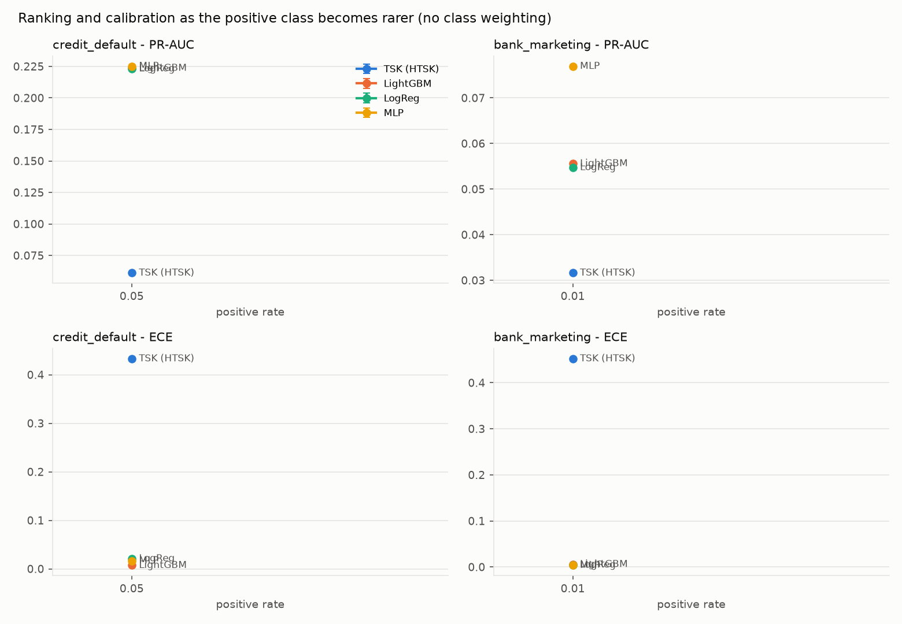
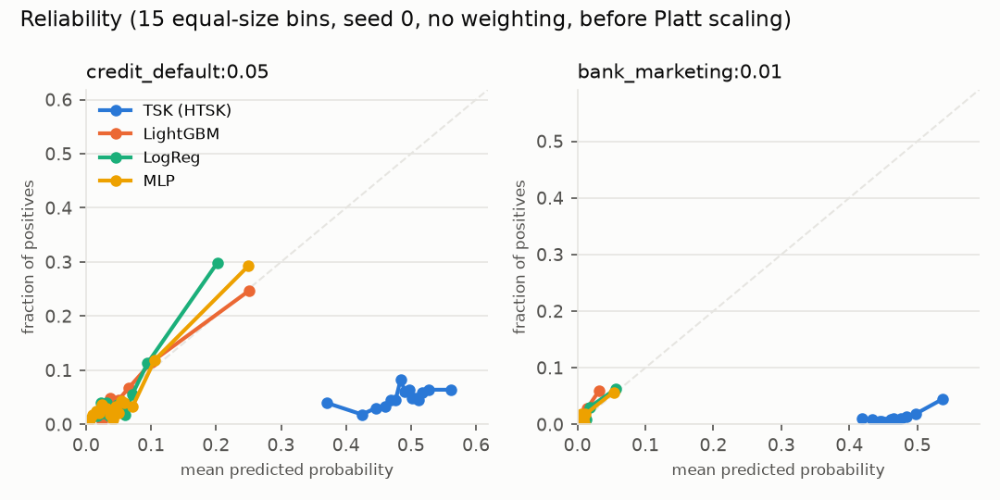

# Results: smoke

Seeds: [0]; configurations per model and setting: 1; max epochs 3, patience 2. Values are mean ± std over seeds.

## Data (seed 0 split)

| setting             |   test_size |   positives_test |   duplicates_train_test |
|:--------------------|------------:|-----------------:|------------------------:|
| credit_default:0.05 |        4920 |              246 |                      12 |
| bank_marketing:0.01 |        7384 |               74 |                     427 |

## Main results (test split)

PR-AUC is the primary metric. `ece` uses 15 equal-size bins; slope 1 / intercept 0 is perfect calibration; `platt_*` are after Platt scaling fitted on the calibration split; F1 at the threshold chosen on the calibration split.

| setting             | model   | class_weight   | pr_auc        | roc_auc       | brier         | ece           | cal_slope     | cal_intercept   | platt_brier   | platt_ece     | f1            |   n_seeds |
|:--------------------|:--------|:---------------|:--------------|:--------------|:--------------|:--------------|:--------------|:----------------|:--------------|:--------------|:--------------|----------:|
| credit_default:0.05 | tsk     | False          | 0.061 ± 0.000 | 0.559 ± 0.000 | 0.236 ± 0.000 | 0.433 ± 0.000 | 0.885 ± 0.000 | -2.894 ± 0.000  | 0.047 ± 0.000 | 0.012 ± 0.000 | 0.095 ± 0.000 |         1 |
| credit_default:0.05 | lgbm    | False          | 0.224 ± 0.000 | 0.747 ± 0.000 | 0.043 ± 0.000 | 0.007 ± 0.000 | 1.050 ± 0.000 | -0.041 ± 0.000  | 0.043 ± 0.000 | 0.007 ± 0.000 | 0.285 ± 0.000 |         1 |
| credit_default:0.05 | logreg  | False          | 0.223 ± 0.000 | 0.760 ± 0.000 | 0.044 ± 0.000 | 0.021 ± 0.000 | 1.182 ± 0.000 | -0.028 ± 0.000  | 0.044 ± 0.000 | 0.022 ± 0.000 | 0.340 ± 0.000 |         1 |
| credit_default:0.05 | mlp     | False          | 0.225 ± 0.000 | 0.760 ± 0.000 | 0.043 ± 0.000 | 0.017 ± 0.000 | 1.083 ± 0.000 | -0.103 ± 0.000  | 0.043 ± 0.000 | 0.020 ± 0.000 | 0.344 ± 0.000 |         1 |
| credit_default:0.05 | tsk     | True           | 0.181 ± 0.000 | 0.746 ± 0.000 | 0.256 ± 0.000 | 0.453 ± 0.000 | 1.783 ± 0.000 | -3.064 ± 0.000  | 0.046 ± 0.000 | 0.023 ± 0.000 | 0.260 ± 0.000 |         1 |
| credit_default:0.05 | lgbm    | True           | 0.201 ± 0.000 | 0.735 ± 0.000 | 0.053 ± 0.000 | 0.077 ± 0.000 | 1.126 ± 0.000 | -1.075 ± 0.000  | 0.045 ± 0.000 | 0.029 ± 0.000 | 0.359 ± 0.000 |         1 |
| credit_default:0.05 | logreg  | True           | 0.213 ± 0.000 | 0.759 ± 0.000 | 0.206 ± 0.000 | 0.383 ± 0.000 | 1.260 ± 0.000 | -2.926 ± 0.000  | 0.044 ± 0.000 | 0.022 ± 0.000 | 0.321 ± 0.000 |         1 |
| credit_default:0.05 | mlp     | True           | 0.229 ± 0.000 | 0.766 ± 0.000 | 0.196 ± 0.000 | 0.381 ± 0.000 | 0.933 ± 0.000 | -3.030 ± 0.000  | 0.044 ± 0.000 | 0.015 ± 0.000 | 0.359 ± 0.000 |         1 |
| bank_marketing:0.01 | tsk     | False          | 0.032 ± 0.000 | 0.684 ± 0.000 | 0.215 ± 0.000 | 0.452 ± 0.000 | 4.507 ± 0.000 | -4.448 ± 0.000  | 0.010 ± 0.000 | 0.004 ± 0.000 | 0.083 ± 0.000 |         1 |
| bank_marketing:0.01 | lgbm    | False          | 0.056 ± 0.000 | 0.770 ± 0.000 | 0.010 ± 0.000 | 0.006 ± 0.000 | 1.584 ± 0.000 | -0.001 ± 0.000  | 0.010 ± 0.000 | 0.003 ± 0.000 | 0.110 ± 0.000 |         1 |
| bank_marketing:0.01 | logreg  | False          | 0.055 ± 0.000 | 0.778 ± 0.000 | 0.010 ± 0.000 | 0.004 ± 0.000 | 1.014 ± 0.000 | 0.000 ± 0.000   | 0.010 ± 0.000 | 0.004 ± 0.000 | 0.079 ± 0.000 |         1 |
| bank_marketing:0.01 | mlp     | False          | 0.077 ± 0.000 | 0.696 ± 0.000 | 0.010 ± 0.000 | 0.004 ± 0.000 | 0.872 ± 0.000 | 0.054 ± 0.000   | 0.010 ± 0.000 | 0.004 ± 0.000 | 0.080 ± 0.000 |         1 |
| bank_marketing:0.01 | tsk     | True           | 0.046 ± 0.000 | 0.774 ± 0.000 | 0.240 ± 0.000 | 0.461 ± 0.000 | 0.979 ± 0.000 | -4.870 ± 0.000  | 0.010 ± 0.000 | 0.005 ± 0.000 | 0.092 ± 0.000 |         1 |
| bank_marketing:0.01 | lgbm    | True           | 0.040 ± 0.000 | 0.741 ± 0.000 | 0.010 ± 0.000 | 0.008 ± 0.000 | 1.907 ± 0.000 | -0.419 ± 0.000  | 0.010 ± 0.000 | 0.005 ± 0.000 | 0.095 ± 0.000 |         1 |
| bank_marketing:0.01 | logreg  | True           | 0.056 ± 0.000 | 0.779 ± 0.000 | 0.157 ± 0.000 | 0.341 ± 0.000 | 0.851 ± 0.000 | -4.584 ± 0.000  | 0.010 ± 0.000 | 0.004 ± 0.000 | 0.097 ± 0.000 |         1 |
| bank_marketing:0.01 | mlp     | True           | 0.077 ± 0.000 | 0.776 ± 0.000 | 0.187 ± 0.000 | 0.404 ± 0.000 | 1.090 ± 0.000 | -4.519 ± 0.000  | 0.010 ± 0.000 | 0.003 ± 0.000 | 0.102 ± 0.000 |         1 |

## Model size and resources

`n_parameters` for LightGBM is its total leaf count (not comparable to rule parameters); `peak_rss_mb` is the process peak and only indicative.

| setting             | model   |   n_features |   n_parameters |   n_rules |   n_trees |   n_leaves |   fit_seconds |   predict_ms_per_1k |   peak_rss_mb |
|:--------------------|:--------|-------------:|---------------:|----------:|----------:|-----------:|--------------:|--------------------:|--------------:|
| credit_default:0.05 | lgbm    |           33 |          346.5 |     nan   |       5.5 |      346.5 |           0.2 |                 0.0 |         382.3 |
| credit_default:0.05 | logreg  |           33 |           34.0 |     nan   |     nan   |      nan   |           0.0 |                 0.0 |         376.0 |
| credit_default:0.05 | mlp     |           33 |          386.0 |     nan   |     nan   |      nan   |           0.0 |                 0.0 |         469.6 |
| credit_default:0.05 | tsk     |           33 |          816.0 |       8.0 |     nan   |      nan   |           0.1 |                 0.0 |         514.5 |
| bank_marketing:0.01 | lgbm    |           62 |          882.0 |     nan   |      14.0 |      882.0 |           0.2 |                 0.0 |         389.7 |
| bank_marketing:0.01 | logreg  |           62 |           63.0 |     nan   |     nan   |      nan   |           0.0 |                 0.0 |         384.9 |
| bank_marketing:0.01 | mlp     |           62 |         3009.0 |     nan   |     nan   |      nan   |           0.1 |                 0.0 |         442.7 |
| bank_marketing:0.01 | tsk     |           62 |          756.0 |       4.0 |     nan   |      nan   |           0.2 |                 0.0 |         501.4 |

## Paired differences, TSK minus baseline (95% bootstrap CI over test rows, pooled over seeds)

Positive PR-AUC favours TSK; negative Brier / ECE favours TSK.

| setting             | class_weight   | baseline   | metric   |   tsk_minus_baseline |   ci_low |   ci_high |   n_seeds |
|:--------------------|:---------------|:-----------|:---------|---------------------:|---------:|----------:|----------:|
| credit_default:0.05 | False          | lgbm       | pr_auc   |              -0.1633 |  -0.2144 |   -0.1137 |         1 |
| credit_default:0.05 | False          | lgbm       | brier    |               0.1932 |   0.1883 |    0.1980 |         1 |
| credit_default:0.05 | False          | lgbm       | ece      |               0.4258 |   0.4139 |    0.4282 |         1 |
| credit_default:0.05 | True           | lgbm       | pr_auc   |              -0.0283 |  -0.0662 |    0.0126 |         1 |
| credit_default:0.05 | True           | lgbm       | brier    |               0.2030 |   0.1980 |    0.2084 |         1 |
| credit_default:0.05 | True           | lgbm       | ece      |               0.3754 |   0.3717 |    0.3788 |         1 |
| bank_marketing:0.01 | False          | lgbm       | pr_auc   |              -0.0240 |  -0.0513 |   -0.0064 |         1 |
| bank_marketing:0.01 | False          | lgbm       | brier    |               0.2049 |   0.2029 |    0.2070 |         1 |
| bank_marketing:0.01 | False          | lgbm       | ece      |               0.4464 |   0.4418 |    0.4491 |         1 |
| bank_marketing:0.01 | True           | lgbm       | pr_auc   |               0.0047 |  -0.0147 |    0.0151 |         1 |
| bank_marketing:0.01 | True           | lgbm       | brier    |               0.2306 |   0.2262 |    0.2344 |         1 |
| bank_marketing:0.01 | True           | lgbm       | ece      |               0.4525 |   0.4481 |    0.4561 |         1 |
| credit_default:0.05 | False          | logreg     | pr_auc   |              -0.1619 |  -0.2124 |   -0.1217 |         1 |
| credit_default:0.05 | False          | logreg     | brier    |               0.1925 |   0.1874 |    0.1973 |         1 |
| credit_default:0.05 | False          | logreg     | ece      |               0.4122 |   0.4018 |    0.4199 |         1 |
| credit_default:0.05 | True           | logreg     | pr_auc   |              -0.0322 |  -0.0622 |   -0.0024 |         1 |
| credit_default:0.05 | True           | logreg     | brier    |               0.0498 |   0.0474 |    0.0525 |         1 |
| credit_default:0.05 | True           | logreg     | ece      |               0.0692 |   0.0664 |    0.0720 |         1 |
| bank_marketing:0.01 | False          | logreg     | pr_auc   |              -0.0231 |  -0.0602 |   -0.0065 |         1 |
| bank_marketing:0.01 | False          | logreg     | brier    |               0.2049 |   0.2030 |    0.2071 |         1 |
| bank_marketing:0.01 | False          | logreg     | ece      |               0.4479 |   0.4435 |    0.4503 |         1 |
| bank_marketing:0.01 | True           | logreg     | pr_auc   |              -0.0100 |  -0.0329 |   -0.0013 |         1 |
| bank_marketing:0.01 | True           | logreg     | brier    |               0.0835 |   0.0825 |    0.0846 |         1 |
| bank_marketing:0.01 | True           | logreg     | ece      |               0.1190 |   0.1176 |    0.1203 |         1 |

## SQ1: effect of the positive rate

## SQ2: TSK ablations (no class weighting; `base` is the selected configuration)

| setting             | model   | variant        | pr_auc        | brier           | ece             |   n_parameters |   n_seeds |
|:--------------------|:--------|:---------------|:--------------|:----------------|:----------------|---------------:|----------:|
| bank_marketing:0.01 | tsk     | base           | 0.032 ± 0.000 | 0.2147 ± 0.0000 | 0.4521 ± 0.0000 |            756 |         1 |
| bank_marketing:0.01 | tsk     | mf=fixed       | 0.042 ± 0.000 | 0.2231 ± 0.0000 | 0.4613 ± 0.0000 |            756 |         1 |
| bank_marketing:0.01 | tsk     | rules=4        | 0.032 ± 0.000 | 0.2147 ± 0.0000 | 0.4521 ± 0.0000 |            756 |         1 |
| bank_marketing:0.01 | tsk     | rules=8        | 0.026 ± 0.000 | 0.2184 ± 0.0000 | 0.4561 ± 0.0000 |           1512 |         1 |
| bank_marketing:0.01 | tsk     | rules=16       | 0.026 ± 0.000 | 0.1529 ± 0.0000 | 0.3749 ± 0.0000 |           3024 |         1 |
| bank_marketing:0.01 | tsk     | ur=off         | 0.032 ± 0.000 | 0.2147 ± 0.0000 | 0.4521 ± 0.0000 |            756 |         1 |
| bank_marketing:0.01 | tsk     | ur=on          | 0.034 ± 0.000 | 0.2144 ± 0.0000 | 0.4518 ± 0.0000 |            756 |         1 |
| bank_marketing:0.01 | logreg  | features=top10 | 0.050 ± 0.000 | 0.0098 ± 0.0000 | 0.0028 ± 0.0000 |             11 |         1 |
| bank_marketing:0.01 | lgbm    | features=top10 | 0.055 ± 0.000 | 0.0098 ± 0.0000 | 0.0070 ± 0.0000 |            693 |         1 |
| bank_marketing:0.01 | mlp     | features=top10 | 0.060 ± 0.000 | 0.0098 ± 0.0000 | 0.0048 ± 0.0000 |            493 |         1 |
| bank_marketing:0.01 | tsk     | features=top10 | 0.012 ± 0.000 | 0.1759 ± 0.0000 | 0.3979 ± 0.0000 |            132 |         1 |
| credit_default:0.05 | tsk     | base           | 0.061 ± 0.000 | 0.2364 ± 0.0000 | 0.4330 ± 0.0000 |            816 |         1 |
| credit_default:0.05 | tsk     | mf=fixed       | 0.061 ± 0.000 | 0.2380 ± 0.0000 | 0.4349 ± 0.0000 |            816 |         1 |
| credit_default:0.05 | tsk     | rules=4        | 0.046 ± 0.000 | 0.2191 ± 0.0000 | 0.4078 ± 0.0000 |            408 |         1 |
| credit_default:0.05 | tsk     | rules=8        | 0.061 ± 0.000 | 0.2364 ± 0.0000 | 0.4330 ± 0.0000 |            816 |         1 |
| credit_default:0.05 | tsk     | rules=16       | 0.070 ± 0.000 | 0.2344 ± 0.0000 | 0.4314 ± 0.0000 |           1632 |         1 |
| credit_default:0.05 | tsk     | ur=off         | 0.060 ± 0.000 | 0.2361 ± 0.0000 | 0.4326 ± 0.0000 |            816 |         1 |
| credit_default:0.05 | tsk     | ur=on          | 0.061 ± 0.000 | 0.2364 ± 0.0000 | 0.4330 ± 0.0000 |            816 |         1 |
| credit_default:0.05 | logreg  | features=top10 | 0.213 ± 0.000 | 0.0444 ± 0.0000 | 0.0201 ± 0.0000 |             11 |         1 |
| credit_default:0.05 | lgbm    | features=top10 | 0.210 ± 0.000 | 0.0435 ± 0.0000 | 0.0108 ± 0.0000 |            567 |         1 |
| credit_default:0.05 | mlp     | features=top10 | 0.161 ± 0.000 | 0.0450 ± 0.0000 | 0.0198 ± 0.0000 |            121 |         1 |
| credit_default:0.05 | tsk     | features=top10 | 0.034 ± 0.000 | 0.2451 ± 0.0000 | 0.4345 ± 0.0000 |            264 |         1 |

## SQ3: class weighting effect (weighted minus unweighted)

| setting             | model   |   d_pr_auc |   d_brier |   d_ece |   d_cal_intercept |   d_cal_slope |   d_platt_ece |   d_recall |    d_f1 |
|:--------------------|:--------|-----------:|----------:|--------:|------------------:|--------------:|--------------:|-----------:|--------:|
| credit_default:0.05 | lgbm    |    -0.0227 |    0.0093 |  0.0700 |           -1.0333 |        0.0761 |        0.0219 |     0.0650 |  0.0743 |
| credit_default:0.05 | logreg  |    -0.0096 |    0.1619 |  0.3626 |           -2.8981 |        0.0787 |       -0.0002 |    -0.0691 | -0.0194 |
| credit_default:0.05 | mlp     |     0.0038 |    0.1534 |  0.3641 |           -2.9269 |       -0.1496 |       -0.0052 |     0.0407 |  0.0154 |
| credit_default:0.05 | tsk     |     0.1201 |    0.0191 |  0.0196 |           -0.1705 |        0.8978 |        0.0115 |     0.0894 |  0.1648 |
| bank_marketing:0.01 | lgbm    |    -0.0158 |    0.0001 |  0.0023 |           -0.4177 |        0.3229 |        0.0020 |    -0.0405 | -0.0147 |
| bank_marketing:0.01 | logreg  |     0.0017 |    0.1472 |  0.3373 |           -4.5841 |       -0.1624 |        0.0002 |     0.0000 |  0.0175 |
| bank_marketing:0.01 | mlp     |     0.0005 |    0.1768 |  0.4009 |           -4.5729 |        0.2184 |       -0.0002 |    -0.0405 |  0.0216 |
| bank_marketing:0.01 | tsk     |     0.0149 |    0.0258 |  0.0084 |           -0.4220 |       -3.5289 |        0.0007 |    -0.1486 |  0.0083 |

## Reliability

## Subgroups on credit default (natural rate, unweighted, mean over seeds)

_no data_

Confident false negatives: `confident_false_negatives_credit_default.csv`.

## Verdict per setting (section 6.4 rules)

| setting             | class_weight   | best_baseline   |   tsk_pr_auc_gap | within_0.02   | tsk_better_calibrated_raw   | tsk_better_calibrated_after_platt   | tsk_smaller_than_best_baseline   | verdict     |
|:--------------------|:---------------|:----------------|-----------------:|:--------------|:----------------------------|:------------------------------------|:---------------------------------|:------------|
| credit_default:0.05 | False          | mlp             |          -0.1639 | False         | False                       | False                               | False                            | contradicts |
| credit_default:0.05 | True           | mlp             |          -0.0476 | False         | False                       | False                               | False                            | contradicts |
| bank_marketing:0.01 | False          | mlp             |          -0.0453 | False         | False                       | False                               | True                             | contradicts |
| bank_marketing:0.01 | True           | mlp             |          -0.0309 | False         | False                       | False                               | True                             | qualifies   |

## Selected configurations

| setting             | model   | class_weight   | config                                                                                                                                                                                                                            |
|:--------------------|:--------|:---------------|:----------------------------------------------------------------------------------------------------------------------------------------------------------------------------------------------------------------------------------|
| bank_marketing:0.01 | logreg  | False          | {"C": 0.0067615350540804935, "max_iter": 2000}                                                                                                                                                                                    |
| bank_marketing:0.01 | logreg  | True           | {"C": 0.0067615350540804935, "max_iter": 2000}                                                                                                                                                                                    |
| bank_marketing:0.01 | lgbm    | False          | {"colsample_bytree": 0.9520760852060981, "early_stopping_rounds": 50, "learning_rate": 0.014344809096017288, "min_child_samples": 50, "n_estimators": 2000, "num_leaves": 63, "reg_lambda": 0.0, "subsample": 0.8523179747521983} |
| bank_marketing:0.01 | lgbm    | True           | {"colsample_bytree": 0.9520760852060981, "early_stopping_rounds": 50, "learning_rate": 0.014344809096017288, "min_child_samples": 50, "n_estimators": 2000, "num_leaves": 63, "reg_lambda": 0.0, "subsample": 0.8523179747521983} |
| bank_marketing:0.01 | mlp     | False          | {"batch_size": 256, "dropout": 0.1, "lr": 0.02088907018470579, "n_layers": 1, "rules_equivalent": 16, "weight_decay": 1e-05}                                                                                                      |
| bank_marketing:0.01 | mlp     | True           | {"batch_size": 256, "dropout": 0.1, "lr": 0.02088907018470579, "n_layers": 1, "rules_equivalent": 16, "weight_decay": 1e-05}                                                                                                      |
| bank_marketing:0.01 | tsk     | False          | {"batch_norm": true, "batch_size": 1024, "learn_mf": true, "lr": 0.0020473475069428754, "n_rules": 4, "sigma_scale": 1.0, "ur_weight": 0.0, "weight_decay": 0.0}                                                                  |
| bank_marketing:0.01 | tsk     | True           | {"batch_norm": true, "batch_size": 1024, "learn_mf": true, "lr": 0.0020473475069428754, "n_rules": 4, "sigma_scale": 1.0, "ur_weight": 0.0, "weight_decay": 0.0}                                                                  |
| credit_default:0.05 | logreg  | False          | {"C": 0.5728759396682656, "max_iter": 2000}                                                                                                                                                                                       |
| credit_default:0.05 | logreg  | True           | {"C": 0.5728759396682656, "max_iter": 2000}                                                                                                                                                                                       |
| credit_default:0.05 | lgbm    | False          | {"colsample_bytree": 0.8309452393904189, "early_stopping_rounds": 50, "learning_rate": 0.1298369077640185, "min_child_samples": 20, "n_estimators": 2000, "num_leaves": 63, "reg_lambda": 0.0, "subsample": 0.8975595268228426}   |
| credit_default:0.05 | lgbm    | True           | {"colsample_bytree": 0.8309452393904189, "early_stopping_rounds": 50, "learning_rate": 0.1298369077640185, "min_child_samples": 20, "n_estimators": 2000, "num_leaves": 63, "reg_lambda": 0.0, "subsample": 0.8975595268228426}   |
| credit_default:0.05 | mlp     | False          | {"batch_size": 512, "dropout": 0.1, "lr": 0.01406757918564448, "n_layers": 1, "rules_equivalent": 4, "weight_decay": 0.0001}                                                                                                      |
| credit_default:0.05 | mlp     | True           | {"batch_size": 512, "dropout": 0.1, "lr": 0.01406757918564448, "n_layers": 1, "rules_equivalent": 4, "weight_decay": 0.0001}                                                                                                      |
| credit_default:0.05 | tsk     | False          | {"batch_norm": true, "batch_size": 1024, "learn_mf": true, "lr": 0.0011293363342404735, "n_rules": 8, "sigma_scale": 1.0, "ur_weight": 1.0, "weight_decay": 0.0}                                                                  |
| credit_default:0.05 | tsk     | True           | {"batch_norm": true, "batch_size": 1024, "learn_mf": true, "lr": 0.0011293363342404735, "n_rules": 8, "sigma_scale": 1.0, "ur_weight": 1.0, "weight_decay": 0.0}                                                                  |
